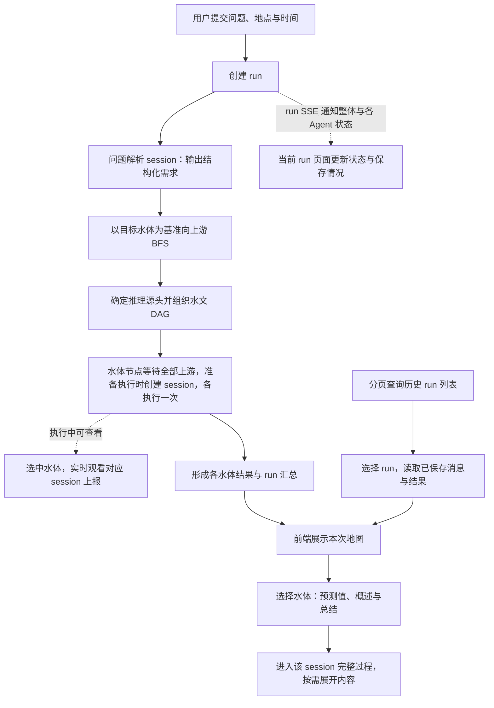

# WaterAgents 后端架构骨架设计

生成日期：2026-09-06

更新日期：2026-10-02

本文档是当前后端架构骨架的最终版，也是给后续设计/实现 agent 阅读的架构引入文档。它只回答最高层问题：WaterAgents 后端要解决什么问题、第一版需要哪些大功能、系统分成哪些层、层与层之间如何协作。

本文档不写 milestone，不分配具体 agent 任务，不选择具体数据库 schema，不展开每个功能的实现细节。后续 milestone 文档会在本文基础上说明需要哪些 agent 完成哪些功能；具体功能设计再由功能实现 agent 逐项细化。

M3 及之后必须承接的已确认功能，统一登记在 [deferred_milestone_contracts.md](deferred_milestone_contracts.md)。

M1–M9 是同一套第一版系统的内部实施切片，不是九个可独立使用或需要互相兼容的产品版本。各阶段的自测只用于开发接力；M9 完成后才开始正式前后端联调和第一版整体验收。在此之前，请求、配置、DTO、SSE、数据库 schema 和测试 fixture 都直接向最终形态演进：新增字段就更新当前唯一模型及其所有消费者，不因进入新的 Milestone 建立 `M4 configuration`、`M4 lifecycle`、旧版只读 union、阶段 feature flag 或中间态迁移层。既有 `content_schema_version` 等协议字段继续使用当前值，不能只因为 Milestone 编号变化而升级；第一版正式验收基线冻结后，才按真实发布兼容需求决定版本和迁移策略。

跨操作系统可迁移性与简单迁移是全局约束（GLOBAL-C11）：macOS、Windows、Linux 共用业务代码、依赖锁、配置格式和 schema，换系统通过目标环境配置与重新安装依赖完成；平台差异只在基础设施入口处理。M3 提供统一检查/启动命令及跨系统迁移验收，历史身份与全文引用不依赖宿主机路径。具体步骤见 [迁移指南](M3/m3_transcript_history_api.md#85-更换操作系统或机器的最短流程)。

M3 工程文档入口：[实施详细设计](M3/m3_transcript_history_implementation_design.md)、[API 与搭建排障指南](M3/m3_transcript_history_api.md)、[Milestone 0–19 实施清单](M3/m3_implementation_todo.md)。M3 已在 `backend/` 实现四表 PostgreSQL 持久化、run/session 状态、history、十个 run 根路由与两层 SSE；Milestone 0–16 保留历史验证证据，原 D01–D86 保留为决策依据。Milestone 17–18 已完成 Windows 正式入口及统一脱敏/性能功能包，Milestone 19 已完成隔离 PostgreSQL、真实 socket、正式服务 smoke 与契约复审；HEAD `def435a` 追加审查的 4 个 P1、1 个 P2 均已本机复审通过，`request changes` 已清除。实际 Windows/Linux runner、三平台完整 CI 与同一 PostgreSQL 跨系统迁移另缺完整证据，因此 GLOBAL-C11 和中心最终承接仍保持 `partial`。

实时交互按 [M3 D69](M3/m3_transcript_history_design.md#d69run-通知与-session-过程使用两层-sse) 使用两层 SSE：当前 run 页面连接轻量 run 通知流，用户打开水体实时过程时再按 D68 连接对应 session 流。run 通知整体状态、新 session、各 Agent 状态和保存情况，session 上报具体过程；GET 用于首次加载、断线核对和历史。用户不能给 Agent 追加消息，停止整次分析只调用 D67 的 run cancel。D65 路由表已同步两条流，关闭时机按 D70，恢复语义按 D73；具体事件、消费身份及握手规则见 M3 API 指南。

领域边界按 [M3 D50](M3/m3_transcript_history_design.md#d50run-覆盖整次分析session-对应独立-agent-上下文) 和 [D51](M3/m3_transcript_history_design.md#d51问题解析-agent-也属于-run-下的独立-session)：run 覆盖一次用户提交的完整分析，是历史分页对象；session 是单个 Agent 的独立上下文与完整执行 loop，包括问题解析 session 和各水体 session。水体 Agent 等待所有上游推理结束后只触发一次。此前整次分析的创建幂等、整体状态、SSE、取消、保存重试和清理职责归到 run；四表职责与两层记录归属已按 D53 确认，路径按 D65 确认，具体列与身份约束见 M3 实施详细设计。完整业务流程见下文第 1.2 节。

M2 的旧整体 session 模型只保留为历史实现证据；当前 `backend/` 已迁移到 M3 的 run 根协议，Agent session 是 run 下的独立上下文，旧 `/api/analysis/sessions` 不提供兼容别名。新后端的需求和契约只以本文档与后续新架构设计为准。`backend_bk/`、`frontend_bk/` 和 `docs/backend_refactor_contract.md` 完全不属于新后端上下文，不能成为需求来源、行为参考、数据源清单、兼容目标或测试 oracle。

## 0. 仓库目录约定

后端重构采用新旧目录分离：

- `backend/`：新后端实现目录。后续所有新架构代码都写在这里。
- `backend_bk/`：与新后端完全独立的旧后端归档，新后端完成后整体丢弃。
- `frontend_bk/`：待重构前端的历史归档，不是新后端或未来新前端的设计输入。

设计、实现、测试、评审和验收 `backend/` 时，Agent 不得读取 `backend_bk/` 或 `frontend_bk/` 来推导功能，也不得导入、复制、适配、枚举或测试归档中的代码与契约。未来前端重构应基于当时确认的产品设计和新后端契约独立完成。只有用户明确要求维护或审计旧系统时才可以单独处理这些归档，且结论不得自动进入新设计。

## 1. 项目背景

WaterAgents 要解决的问题是：在美国，并不是每条河流或水体都有对应检测站。即使附近有检测站，也会遇到时间覆盖不足、参数缺失、冬季冰冻、设备异常或局部数据不稳定等情况。因此用户很难直接获得任意水体在任意时间窗口内的水质状态。

系统目标不是简单查询数据库，而是基于有限证据生成一个可解释判断：

```text
目标水体 + 时间窗口 + 目标参数
  -> 读数或趋势/风险判断
  -> 证据链
  -> 置信度
  -> 归因总结
  -> 可展开的具体分析过程
```

第一版核心业务能力是“推测”，其中包含两种模式：

- 补全：历史时间窗口内，当目标水体或目标参数缺失时，基于检测站、上游结果、流量、天气、历史记忆等证据补全。
- 预测：未来时间窗口内，基于最近观测、上游结果、流量、天气预报、历史记忆等证据预测。

补全和预测不是两套系统，而是同一条推理流程在不同时间段上的两种模式。跨越当前日期的请求可以拆成历史补全段和未来预测段。

归因不是第一版独立前端功能，而是每次推测结果必须附带的能力。结果中需要区分：

- `analysis_detail`：具体分析过程，适合用户点进详情页后查看。
- `attribution_summary`：归因总结，适合前端结果卡片直接展示。
- `evidence_chain`：支撑分析和归因的证据引用。

### 1.1 run、session 与水体的关系

| 概念 | 含义与归属 |
|---|---|
| run | 一次用户提交所开启的完整分析，从问题解析、拓扑查找到各 Agent 输出结束。创建幂等、整次分析状态、SSE、取消、保存重试及历史列表分页归到这一层。run 从提交时就存在，不等分析完成后才创建。 |
| 问题解析 session | 属于该 run 的独立 Agent 上下文，保存输入、调用过程和结构化输出；会话职责不绑定水体 COMID，但解析结果可以包含目标 COMID、坐标等业务事实。 |
| 水体 session | 属于该 run 并绑定一个 COMID 的独立 Agent 上下文；从接收输入、获取证据到输出最终结果是一个完整 loop。同一 run 内每个水体 Agent 等所有上游推理完成后只触发一次。 |
| COMID | 水体的业务身份。同一水体可以参与不同 run，每次使用所属 run 中的独立 session，不因 COMID 或 query 相同而复用本次执行上下文。 |

身份字段按 [M3 D52](M3/m3_transcript_history_design.md#d52session_id-统一标识-agent-执行取消重复-agent_id)：run_id 关联整次分析，session_id 统一标识一个 Agent 的独立上下文和本次完整执行；取消原先同义的执行 agent_id。agent_role 表达问题解析或水体推理职责，target_comid 表达适用水体，operation_id 标识一次模型/工具等调用。保存重试与历史读取保留原身份，同一调用的开始、结束和直接关联 hook 复用 operation_id。

按 [M3 D53](M3/m3_transcript_history_design.md#d53四张核心表会话状态与两层记录归属)，每个 Agent session 保存自身必要状态和时间，用于判断是否开始、是否结束、是否失败；run 整体状态不能替代各 session 的状态。用户原始请求、run 创建事件和后端 BFS 等记录属于 run，问题解析及水体 Agent 的实际消息属于各自 session，公共记录不能全部塞进解析 session。角色与水体归属优先从 session 取得，完整请求、配置、过程和结果保留于原记录；run 汇总可以表达整体结论并引用水体结果。

按 [M3 D54](M3/m3_transcript_history_design.md#d54所有业务表的每条记录都保留时间信息) 和 [D55](M3/m3_transcript_history_design.md#d55通用时间最多两列occurred_at-复用创建时间)，所有业务表每条记录都保留时间信息；M3 的 run/session 表使用 created_at、updated_at，追加后不可变的原记录/大正文表仅使用 created_at。transcript 的 API occurred_at 从原记录 created_at 装配，数据库不再独立保存同义时间列。时间在原创建或真实变更时确定，读取和补写不刷新；观测时间、预测窗口等真实业务时间仍保留于正文。

session 表示真实的上下文边界。各 Agent 只接收流程明确传入的消息、上游结果与证据；统一存储 transcript 不意味着把整次 run 的消息都放入每个 Agent 的上下文。BFS 等确定性后端步骤属于 run 的过程记录，本身不另建 Agent session。公共内容通过原记录引用复用，问题解析 session 与水体 session 共用记录模型、内容解析及全文读取能力。

创建时机按 [M3 D59](M3/m3_transcript_history_design.md#d59agent-准备执行时创建-session)：问题解析 Agent 在准备解析时创建 session；水体 Agent 等所有上游推理完成、满足执行条件并准备开始自己的 loop 时才创建 session。DAG 确定时不预建全部会话，尚未执行的节点由 run 拓扑及实际过程记录表示，没有 Agent 会话可读。已创建 session 随后失败或取消仍保留自身身份、状态和已有记录；运行中创建沿用增量持久化规则，保存重试不重新创建或执行 Agent。

session 状态按 [M3 D60](M3/m3_transcript_history_design.md#d60agent-session-使用五种执行状态) 使用 pending、running、completed、failed、cancelled。pending 表示已经创建并准备执行，不包含等待上游；准备失败或取消可直接结束，running 则以完成、失败或取消结束。终态不改写，run 后续取消也保留各已完成 session 的 completed。保存进度和警告继续按 run 管理，session 不增加 completed_with_persistence_error；业务完成不能代替全部保存确认。

服务重启按 [M3 D61](M3/m3_transcript_history_design.md#d61重启时分别处理-run-与-session-的遗留状态) 分别检查 PostgreSQL 中的 run 与 session：仍为 pending/running 的记录转为 failed，原因是 service_interrupted；各层已保存的终态保持不变。即使 run 已终态，也检查其遗留非终态 session。保留原身份和已保存过程，修正及适用中断记录同事务提交；不补造未保存会话或内容，不重新执行分析。

应用启动按 [M3 D62](M3/m3_transcript_history_design.md#d62启动检查全部成功后才接收请求)，依次通过 PostgreSQL 连接检查、schema 版本检查和 D61 遗留处理后，才对外接收请求。任一步失败则本次启动失败退出，输出脱敏原因和修复提示；需要初始化/升级时提示执行独立命令，启动过程不自动改表。服务已启动后的运行中持久化故障继续沿用保留内存与补写规则，新 run 仍须确认创建提交后才能开始分析。

schema 版本按 [M3 D63](M3/m3_transcript_history_design.md#d63schema-版本严格匹配统一由-alembic-管理) 统一由 Alembic 管理，只接受当前代码要求的版本，不另存一套同义版本号或维护跨结构版本兼容。未初始化或需要升级时提示独立命令，较新或无法识别时提示核对代码与数据库，均按 D62 退出且不自动降级。该检查不替代 transcript 和 SSE 各自的内容/事件版本处理。

### 1.2 从用户提问到历史记录阅读的完整流程

以下是已确认的主流程，供后续设计、实现和前端接入共同参考。

1. **用户提交问题，创建 run。** 用户输入 query，在地图选择 COMID/坐标、日期、时间粒度，并分别选择解析模型和水体模型；前端不提供参数表单。一次新的提交创建一个新的 run；即使 query 相同，新的用户操作也使用新的创建 key。只有请求重试才原样复用 key 和请求体，重试返回原创建回执，不重新执行分析。
2. **准备解析时创建问题解析 session。** 问题解析 Agent 从 query 提取或自主推测参数，并在前端 target/date 缺失时给出候选；它没有 geocoding、NLDI 或参数搜索工具权限。随后确定性 resolver 验证 CONUS/COMID、日期、实际粒度、mode 与 ParameterKey。该 session 的安全输入、实际模型过程及唯一 `AnalysisContext` 归属于本次 run；缺失、冲突、歧义、unsupported 或越界在 topology 前失败。
3. **后端向上游寻找推理源头。** 以解析出的目标水体为基准，沿水文网络向上游做有界稳定 BFS。NLDI 提供河网/站点关联，WDFN v1 metadata 按“参数 × 时间段”判断候选 inlet；每条支流找到最近充分来源后只停止已覆盖单元。完整搜索范围、active path union、自然无源和上限停止均保留，技术故障不冒充无数据。
4. **组织 DAG 并按依赖调度。** 后端依据水文网络构建有向无环图，组织水体 Agent 之间的信息传递。从推理源头开始执行；一个水体 Agent 必须等所有上游推理完成后才开始，同一 run 中只触发一次。汇流节点不能收到一个上游结果就提前执行，其他上游结果也不触发第二次 session。
5. **准备执行时创建水体 session，完成自己的推理 loop。** 该水体满足执行条件后创建独立 session，接收输入与上游结果，通过工具等外部能力收集证据，完成推理并输出该水体结果。过程中的真实消息、调用、证据、错误和最终结果保留稳定身份及引用；结果沿 DAG 传给下游。各 session 的结果保持各自归属，整次 run 的汇总引用这些原结果。尚未进入执行准备的水体不预建空 session，已创建会话失败或取消仍保留已有事实。
6. **完成整次分析并保存过程。** 当本次分析的各 Agent 输出结束，形成 run 的整体结果。记录在执行过程中按持久化规则持续保存，不等结束后才一次性保存。创建幂等、状态与适用记录原子提交、补写重试、凭据脱敏和清理门槛沿用 M3 契约；保存重试不会重跑问题解析或水体 Agent，业务完成也不能代替全部保存确认。
7. **用户在地图上查看本次结果。** 完成后，地图显示每个实际参与推理的水体。用户点击水体，查看其分时段结果、逐窗口综合风险、日期范围总体风险、availability 和理由；再从结果入口进入该 waterbody Agent session 的完整真实上下文。skill、tool、hook 等内容按语义默认折叠，用户可以展开具体内容。
8. **用户从历史列表重新打开某次 run。** query 历史列表按 run 分页，一行代表一次用户提交的分析，同 query 的不同 run 不合并。用户选择某个历史 run，前端根据当次已保存的消息、业务结果及引用展示地图标点和连线；再点击水体，查看该 run 下对应 session 的结果和多层过程。历史链路只读取 PostgreSQL 已保存的事实，不重新解析或推理，不用当前结果替换旧结果，也不从内存补齐后宣称已经保存。

**执行中的观察与停止。** 按 D66，上述执行过程进行中，用户就可以选中已有 session 的水体观看实时上报，无需等待第 6 步完成，也无需先有最终预测才能进入过程。此时仅展示已经产生的可见内容，未创建 session 的节点不补造会话。用户不能向 Agent 追加消息，但可通过 run 级 cancel 停止整次分析。按 [D67](M3/m3_transcript_history_design.md#d67只公开-run-取消由后端传递到各-session)，前端只调用一次 run cancel；后端先阻止解析、BFS 和后续 DAG 调度，再调用内部取消能力通知所有已创建的未终态 session，不额外公开单独 Agent cancel HTTP 接口。已终态 session 保留原状态，晚到输出不继续向前端或下游传播；受理取消与在途调用实际收敛区分，已有过程保存及补写继续进行。具体 SSE 协议继续对齐，关闭查看连接本身不取消分析。

**按查看需要连接。** 按 [D68](M3/m3_transcript_history_design.md#d68按查看需要订阅水体-session已结束与历史使用统一读取)，用户打开所选水体的实时过程时才订阅对应 session；切换水体或关闭过程视图时关闭旧订阅，进入 run 页面不自动连接全部 Agent。D69 同时要求当前 run 页面保持一条轻量 run 通知流，以获知整体状态、新 session、各 Agent 状态及保存变化，切换水体不关闭该通知流。未被查看的 Agent 照常执行并保存，打开前已经产生的全部可见过程也须能读全。Agent 已结束或查看历史时，通过统一读取接口取得完整记录和全文；已结束的当前读取仍保留 auto 与持久化警告，历史使用 view=history。GET 也用于首次加载和断线核对，关闭时机按 D70、首次过程衔接按 D75、结束通知按 D76；公开 payload、消费身份与握手以 M3 API 指南和 OpenAPI 为准。

首次过程订阅按 [D75](M3/m3_transcript_history_design.md#d75首次订阅-session-流先发送已有过程再持续推送新增记录)：对未结束 Agent 无游标连接 session SSE，先发送该 session 已有的全部可见记录，再持续推送新增记录，无需先 GET transcript；两段之间新增的记录不能遗漏。重连沿 D73 游标补齐，已结束 Agent/历史仍用统一 GET，大正文和公共引用保持原读取方式。两种读取复用原记录及解析，不增加独立存储副本。

逐步显示按 [D79](M3/m3_transcript_history_design.md#d79实时增量推送数据库按消息保存一份正文)：用户查看水体过程时，session SSE 可持续发送正在生成的文本片段，并按稳定消息身份更新同一条消息。数据库按消息保存组装后的正文一份，历史读取已保存的整条消息与完整过程；失败/取消保留实际内容及未完成语义。片段须在推送前支持跨片段凭据脱敏，live 续传和取消可见性保持原义；保存状态按 [D80](M3/m3_transcript_history_design.md#d80未定稿正文计入-pending整理后再触发写入)：已产生但未定稿的必需正文计入 pending，无实际错误则 warning=null；结束或中断后整理写入，等待生成不消耗重试，其他可写内容照常保存，已有耗尽及错误优先保留。未完成消息 DTO、三阶段事件和取消边界已由 M3 API 指南与运行时实现冻结。

消息身份按 [D81](M3/m3_transcript_history_design.md#d81流式片段与最终消息复用-item_id)：一条消息开始生成时分配 item_id，文本片段与最终正文复用，前端持续更新同一消息。SSE id 独立用于续传和片段去重；提前分配消息身份不触发数据库占位或正文写入，结束或中断后仍按原规则整理保存。

消息顺序与时间按 [D82](M3/m3_transcript_history_design.md#d82消息开始时固定过程序号和创建时间) 在开始生成时一起固定，API occurred_at 复用原 created_at，完成或补写后不移动消息位置、不更新时间。信息先留在内存，其他可写记录照常保存；历史按原序号排列，保存确认以实际提交内容为准，不能因后续序号已保存而遗漏前面的未定稿消息。

消息生成状态按 [D83](M3/m3_transcript_history_design.md#d83消息正文使用三种-generation_status) 由正文中的 generation_status 表达：generating 为 live 中正在生成，completed 为消息正常结束，incomplete 为取消、错误或截断造成的未完整生成。整理后按 completed/incomplete 保存实际正文，不新增同义数据库状态列；消息状态不替代 Agent/run 终态或保存确认，后续执行失败不改写已正常生成完的消息。

取消中的消息按 [D84](M3/m3_transcript_history_design.md#d84取消时固定原消息晚到正文另存审计)：后端接受 run cancel 时固定已接收正文并标为 incomplete，保留原消息身份、位置和时间；晚到片段合并为显式引用原消息的独立审计，只保存新增内容。当前 GET/SSE、全文引用及下游保持取消边界，严格历史可读取已保存的前后关联。审计沿用原四表及保存规则，取消不增加数据库同步等待，全部适用内容仍须保存后才能清理。

消息定稿按 [D85](M3/m3_transcript_history_design.md#d85消息定稿时发送-message_finalized) 使用 session 过程事件 message_finalized：正常结束或中断、正文整理后携带原消息表示，不等待保存，也不另存同义 transcript。前端结束该消息的打字状态，Agent 可继续其他消息；正文仍按内联或预览/全文引用装载，取消时只返回边界前原正文。事件沿原 SSE id 续传，先于 session stream_end，消息定稿与执行结束、保存确认分别表达。



### 1.3 历史阅读与展示边界

水体展示按 [M3 D71](M3/m3_transcript_history_design.md#d71run-通知使用完整轻量快照水体区分五种展示状态) 覆盖本次 BFS 范围：不参与推理为半透明灰色，参与但未开始为灰色，正在推理为蓝色，完成为绿色，出错为红色。前两种状态可发生在 session 创建之前，由原 BFS/推理范围与调度事实表达；不预建 session，也不因没有 session 从地图范围丢弃水体。颜色由前端映射，取消后的呈现按 [D72](M3/m3_transcript_history_design.md#d72取消后的水体展示延后到前端设计) 留到 M9 前端设计，原 session 真实状态保留。

run 通知采用 D71 完整轻量状态快照，包含 run、实际会话简要信息、保存情况及上述水体参与/执行情况。GET 与通知复用原事实装配，不另存地图状态或颜色副本；历史读取使用当次已保存的 BFS、调度和 session 事实，不重新分析。具体条目与引用组织随 DTO 去重原则定型，完整请求、配置、过程与结果正文仍从原记录读取。

完整分析记录必须在用户选中水体后展示；未选水体时不展示混合的全 run 过程。进入水体上下文时，接口一次返回该 session 的完整有序记录列表，再读取其中显式引用的公共上下文，不能只取最终总结挑选的几条记录。Agent 记录在接口和前端都不分页；分页只用于 run 历史列表。

定位按 [M3 D64](M3/m3_transcript_history_design.md#d64run-详情提供会话信息按-run-与-session-定位水体过程)：run 详情提供已创建 session 的 session_id、角色、适用 COMID 和自身状态；前端选中水体后取得对应 session_id，用 run_id + session_id 读取结果和完整过程，后端校验所属 run。对应信息从原 session 装配，不另存目录或映射表，不再增加按 COMID 定位同一 Agent 过程的第二套接口。历史只返回已保存的会话信息，未创建的节点不补造空会话；解析 session 不绑定 COMID，也不成为地图水体节点。

记录顺序按 [M3 D56](M3/m3_transcript_history_design.md#d56每个-run-统一分配-transcript_sequence)：每个 run 统一分配 transcript_sequence，run 自身与所有 Agent session 的记录共同编号；并发记录按统一入口追加顺序排列。session 读取保留筛选后的原序号，公共引用也保留原序号，不另维护 session 局部 transcript 编号。保存重试不改变顺序，SSE 仍使用独立事件序号。

全文引用按 [M3 D57](M3/m3_transcript_history_design.md#d57全文引用统一使用-run_id-与-item_id) 使用 run_id + item_id，覆盖 run 公共记录和各 session 记录，读取时核对 item 属于指定 run。session_id 继续用于定位 Agent 的完整过程，公共记录无需借用解析 session 身份。引用返回时从原身份组装，不另存同义对象、URL 或公开 content_id；内联和独立大正文沿用同一引用，来源和可见性仍按当前/历史语义处理。

关联边界按 [M3 D58](M3/m3_transcript_history_design.md#d58普通过程引用限于同一-run历史证据显式关联)：普通 transcript_item_refs 允许引用同一 run 的公共记录或其他 session 的原记录，禁止混入其他 run 的普通过程。跨 run 证据由 M8 的历史来源结构显式关联，保留原身份与置信度，可通过原 run/item 引用读取。stateless 不使用跨 run 历史记忆，本次 run 内的上游结果传递继续保留；完整水体过程仍先读所属 session 全部记录，再读取显式公共引用。

小正文随记录列表返回，大正文返回预览和原 item 引用，展开时可读取完整正文。内容大小决定存储与传输方式，skill/tool/hook 等内容的默认折叠由语义决定，两者互不替代。完整列表表示所选来源当前可读取的完整记录集合，不表示未来不会追加，也不表示尚未保存的内容已经成为历史。

地图标点和连线的组织、含义及画法由前端设计；后端保存并提供原消息、其中已有的真实业务字段及引用，不为地图增加额外采集、渲染字段或独立快照。后端用于实际分析的水文 DAG 与依赖调度仍属于业务流程。M6 已将综合水质语义定型为 Agent 给出的分类风险判断，并由后端另行装配 evidence availability；上游失败时的调度语义由 M7 定型。本节不据此新增问题解析 session 的独立前端入口。

详细约束见 [前端接入约定](frontend_integration_contracts.md)、[M3 D44–D51](M3/m3_transcript_history_design.md#d44query-历史列表分页按当次地图进入连续会话记录) 和跨 Milestone 契约 `M4-C01`、`M4-C06`、`M6-C14`、`M7-C01`、`M7-C08`、`M9-C10`。M3 的路径、run/session DTO 与数据库结构已经冻结并实现；M4–M9 只在真实业务生产方接入后扩展相应字段，不能用 M2 的旧整体 session_id 充当独立 Agent session_id。

## 2. 第一版大功能范围

第一版 demo 需要跑通这 8 个大功能：

1. Analysis Run + Agent Sessions
   - 创建分析任务。
   - 用 SSE 向前端推送实时事件。
   - 支持整次 run 的显式取消。
   - 支持历史 run 列表、详情和所属 Agent session 的 transcript 查看。

2. Query Understanding
   - 问题解析 Agent 在 run 下执行一个独立 session，保存自身输入、调用过程与结构化输出。
   - 前端 target/date 有值时优先，缺失时才使用 query 候选；front/query 实质冲突不静默覆盖。
   - 参数只由 query parser 提取或自主推测，few-shot 不构成硬编码模板；deterministic capability registry 最终映射 ParameterKey，不能按向量最高项直接执行。第一版正式联调按 [M4 参数能力目录](M4/m4_parameter_capability_catalog.md) 接通 154 项能力，单次最多 6 个用户目标，必需 discharge 不占上限。
   - 第一版只支持 CONUS、当地今天前后各 7 天，以及 `auto/6h/12h/24h`；mode 从日期确定性推导。
   - 前端分别选择 parser/waterbody model，parser 无外部工具权限；memory mode 作为 M8 接缝固化。

3. Hydrology Topology
   - 以目标 COMID 为基准，按参数 × 时间段向上游 BFS，寻找每条支流最近的合格 evidence source。
   - 默认限制 100 km/路径、12 hop/路径、128 node/图和 8 并发，稳定生成完整范围、active/excluded、排除原因与 DAG 顺序。
   - M4 availability metadata 只是候选资格；M5 仍须读取并校验真实数据。

4. Evidence System
   - 以当前水体 session 为 scope，通过统一 evidence tools 按需获取、组织和追踪证据，不在 topology 后对整图预取。
   - 有合格本地站点的水体先查询本站目标参数和 discharge；无站水体不制造本地空查询，而是消费直接上游结果并按需取证。
   - discharge 是每个水体、每个最终窗口的必需支持参数；天气/预报、EPA facility 和历史 transcript/RAG 始终按任务与 evidence relation 按需调用。

5. Agent Reasoning
   - 按 DAG 运行水体 Agent；各自在独立 session 中等待所有上游完成后执行一次完整 loop。
   - 同一流程支持补全、预测和混合时间段。
   - 每次结果必须带读数或趋势/风险判断、置信度、证据链、具体分析和归因总结。

6. Result Model
   - 支持 `6h / 12h / 24h` 时间粒度。
   - 前端粒度默认 `auto`：1–7 个日历日解析为 6h，8–15 日解析为 12h；非前端 API 省略字段才使用 `12h/default`。
   - 每个时间窗口标记 `observed / inferred / predicted`。
   - 支持每个时间窗、每个参数和整体结果的置信度。

7. Memory / RAG
   - transcript 是历史事实源。
   - RAG 从 transcript 中可检索的 item 建索引。
   - 历史记忆可以作为 evidence，但不能覆盖当前真实检测站数据。

8. Settings / Keys / Admin
   - 管理 provider、model、API key、运行参数默认值。
   - 提供清理增长型数据的 admin 能力，例如 run 历史及所属 sessions、transcript、RAG index、cache。
   - 清理接口不应删除 API keys。

第二版再加入 Evaluation / Accuracy Benchmark，用于正确率评估、holdout 测试、误差分析和推理质量优化。第一版只预留架构位置，不要求实现 benchmark。

## 3. 架构原则

消息过程按 [M3 D86](M3/m3_transcript_history_design.md#d86消息流划分为开始增量和定稿事件) 使用 message_started、message_delta、message_finalized 三个阶段，分别提供原元信息、新增文本和定稿表示；共用所属 session 的 SSE 编号，数据库继续保存整理后的原消息正文。工程细节由实现者在既定用户行为和持久化保证内直接定型，阶段交付按 [M3 实施清单](M3/m3_implementation_todo.md) 承接。

### 3.1 输出是判断，不是裸读数

系统最终交付的是带证据链和置信度的判断。判断里必须包含最终读数；但当证据不足以给出可信具体数值时，系统应返回趋势/风险判断，而不是硬编数字。

### 3.2 检测站数据是锚点

如果目标 COMID、目标参数、目标时间窗口有真实检测站读数，agent 不允许随便改该读数。agent 可以补充：

- 置信度说明
- 覆盖率和质量标记
- 异常标记
- 归因总结
- 周边证据解释

如果检测站覆盖率不足，例如只有部分时间窗口有读数，则有真实读数的窗口锚定检测站，缺失窗口再由 agent 补全。每个窗口都必须标记来源。

M5 不跨 observation series 自动判定“明显冲突”或选择赢家。Agent 必须根据 system prompt 检查 station、时间、method、quality 等差异，引用所有影响判断的记录并解释选择或保持不确定；不得静默丢弃相反记录。只有一对一采用当前水体的一条具体直接观测（允许可逆确定性单位展示转换）可标记为 `observed`；任何多记录聚合、跨 series 选择、加权、折中或综合结果必须标记为 `inferred`。

### 3.3 证据不足时保持保守

如果目标 COMID 没有直接检测站读数，但 capability registry 明确允许使用同参数上游、相邻时间基线或特定环境关系等侧面证据，可以输出受限的趋势/风险判断；必须展示证据限制，不能伪装为 observed。confidence 由 Agent 根据证据质量、覆盖和推理跨度判断，后端不设置“侧面证据固定减多少”的公式。

如果某个“参数 × 时间段”完全没有直接或允许的侧面证据，则不将它放入 final reasoning，由确定性逻辑输出 `indeterminate / insufficient_evidence`。station-backed preflight 成功但全部范围自然无证据时不启动 planning 或 final reasoning；stationless 缺少本地观测是正常起点，可以先用有界 Agent planning 寻找上游、天气、设施或其他允许的证据，最终全部不足时只保证 0 次 final reasoning。外部服务 unavailable/invalid 不是“无证据”，必须按技术 blocker 处理。

### 3.4 Evidence 是 agent 推理的中心

所有进入推理判断的事实都要成为结构化 evidence，不能只作为 prompt 文本散落存在。Reasoning layer 可以动态调用 evidence tools 或 subagents，但最终参与判断的内容都必须落为可追踪的 `EvidenceFragment` 或 `EvidenceBundle`。

### 3.5 Tool 调用等级由 policy 决定

所有外部信息能力本质上都是 evidence tools。mandatory、conditional-mandatory 和 optional 在技术上共用 registry/executor，区别由确定性 policy 与 Agent roster 决定：

- conditional-mandatory tools：当前水体有合格本地 station refs 时，模型推理前必须先查询本地 observation/discharge；无站水体不注册该调用。
- mandatory evidence requirement：每个目标参数窗口都必须有 discharge direct 或 capability 允许的 indirect evidence；它不等于每个水体都能调用本地 discharge provider。
- optional tools：agent 根据任务和证据缺口按需调用。

天气 observation/forecast、EPA facility 和历史检索均是 optional。直接上游结果由 M7 在依赖收敛后注入，不允许下游 Agent 越权查询上游站点。

### 3.6 Transcript 是事实源

每次分析的过程要保存为 transcript。Transcript 中记录请求、上下文、tools 结果、agent/subagent 会话、证据、结果和错误状态。

跨会话 memory/RAG 不另建一套神秘记忆系统，而是从 transcript 中可检索的 item 生成索引视图。

### 3.7 第一版优先跑通主流程

第一版 demo 不需要解决所有异常和边界情况。复杂失败处理、精细 replay、数据库性能优化、准确率 benchmark 可以记录设计入口，后续版本再做。

### 3.8 跨平台运行是基础约束

新后端必须支持 macOS、Windows 和 Linux，不能把当前开发机行为当作运行时契约。生产代码不硬编码 POSIX 路径、`/tmp`、shell 命令或 macOS 专用能力；文件路径使用 Python 标准库抽象，启动和测试入口通过 Python 模块调用保持一致。依赖需要在三个目标平台的受支持 Python 版本上可安装，其中 IANA timezone 数据不能假设由操作系统提供。

## 4. 总体分层

建议采用以领域和应用为中心的分层架构。外部 API、LLM provider、数据库、缓存、第三方数据源都放在边缘，通过 ports/adapters 接入。

```text
Frontend
  |
  v
[1] Interface / API Layer
  |
  v
[2] Application / Workflow Layer
  |
  +--> [3] Domain Layer
  |
  +--> [4] Evidence & Tool Layer
  |
  +--> [5] Reasoning & Agent Layer
  |
  +--> [6] Transcript / Memory / RAG Layer
  |
  +--> [7] Ports
             ^
             |
[8] Infrastructure Adapters & Persistence
```

依赖方向：

- Interface 依赖 Application。
- Application 编排 Domain、Evidence、Reasoning、Transcript 和 Ports。
- Domain 不依赖 Web 框架、数据库、LLM 框架或第三方 API。
- Evidence 和 Reasoning 依赖 Domain 与 Ports，不直接依赖具体外部 API。
- Infrastructure 只实现 Ports，不反向调用 Application。

## 5. Interface / API Layer

Interface 层负责对外协议，不负责水文业务推理。

### 5.1 新主协议：run 与 session 两层 SSE

整次分析以 run 为入口，Agent 在其所属 run 下拥有独立 session。M3 已在 `backend/` 实现以下 [D65](M3/m3_transcript_history_design.md#d65接口以-runs-为根嵌套读取独立-session) 路径，并同步 OpenAPI、文档、测试和 smoke；这些路径已经替换 M2 旧整体 session 路径，不保留旧路径兼容别名。

```text
POST /api/analysis/runs
GET  /api/analysis/runs
GET  /api/analysis/runs/{run_id}
GET  /api/analysis/runs/{run_id}/sessions/{session_id}
GET  /api/analysis/runs/{run_id}/sessions/{session_id}/transcript
GET  /api/analysis/runs/{run_id}/transcript/{item_id}/content
GET  /api/analysis/runs/{run_id}/events
GET  /api/analysis/runs/{run_id}/sessions/{session_id}/events
POST /api/analysis/runs/{run_id}/cancel
POST /api/analysis/runs/{run_id}/persistence/retry
```

创建 run 按 D02 确认创建事务提交后才启动分析，幂等重试按 D11–D15 返回原创建回执。D69 保留 run 通知 SSE，并新增所属 session 的过程 SSE，后者校验 run_id + session_id 归属。取消与补写属于 run；手动补写沿用 D41 的无请求体协议和受理语义，不重新执行分析。

历史列表按 D47–D50 只读 PostgreSQL：limit 默认 50、允许整数 1–200，按 created_at DESC/run_id DESC 游标分页，返回 items/next_cursor，不返回总条数。首版参数只有 limit/cursor；游标按 D48 编码原版本与末条 created_at/run_id，前端原样传回。状态更新不改变列表位置，数据库错误不返回假空列表，非法参数或游标返回 422。

run 详情包含当前信息、存在时的原业务结果，以及 D64 的会话简要信息。前端选中水体后，以 run_id + session_id 读取 Agent 详情和实际结果，再读取该 session 的完整有序过程与显式公共引用。Agent 过程不分页，run 详情不混入所有 Agent 消息；M3 未产生的业务结果不预造占位摘要。

run 详情、Agent 详情、Agent 过程和原 item 全文沿用 D42/D43：view 省略或 auto 时默认 live state 存在则读内存、释放后读 PostgreSQL，view=history 只读已保存事实并返回 persistence=null；保留持久化警告与取消可见性。所有后续全文与公共引用读取保持所选模式，非法 view 返回 422，SSE 410 历史入口明确使用 view=history。

全文使用 run_id + item_id，覆盖 run 公共记录及所属 Agent 记录，不增加第三个必需 session_id，也不增加独立 /current 或按 COMID 定位的第二套过程接口。内联正文与独立大正文共用此全文入口。

run 列表返回 run_id、status、created_at、updated_at、query 和当前阶段已确认的配置表示，配置从原创建事件装配；M3 DTO 与 SSE 生命周期事件名称以当前 OpenAPI、production registry 和 SSE encoder 为准。后续业务字段只随 M4–M9 的真实生产阶段扩展。

### 5.2 SSE 事件

按 D69 分为两类流，复用同一客户端和已有事实装配能力：

| 流 | 内容与连接 |
|---|---|
| run 通知 SSE | 当前 run 页面建立连接，推送 run 状态、新创建的 session、各 Agent 状态和保存情况变化；通知保持轻量。 |
| session 过程 SSE | 打开水体实时过程时按需连接，按 D79 推送所选 Agent 的文本片段及其他消息、工具调用、证据和结果；组装正文的大内容存储沿用预览/引用与全文读取。 |

run 通知从原状态机、session 事实和写入器状态生成，不重复传输或保存完整 Agent 消息，不因通知再追加同义持久化记录。GET 详情继续负责首次加载、断线核对和历史读取；当前页面不采用持续轮询。历史只读已保存事实，实时通知不作为已保存证明。

D70 已确认两流正常关闭条件，替代原 M2 单流业务终态即关闭假设；结束通知按 D76 使用 stream_end，首次过程衔接按 D75，事件名称、payload、续传身份及握手由当前 M3 API 指南、OpenAPI 与 SSE encoder 固定。业务终态仍只确定一次，终态后的保存变化可由 run 流通知，不能把保存通知当作第二个业务终态。M4–M7 按真实生产内容接入，Interface 层保证公开类型与版本稳定。

两层流按 [M3 D70](M3/m3_transcript_history_design.md#d70两层-sse-分别结束run-流等待收敛与保存完成) 分别结束：Agent 已结束并发完可见过程后关闭 session 流；run 业务已终态、执行已收敛且必需内容及状态全部确认保存后关闭 run 流，不额外等待 60 秒内存保留期。保存仍在进行或重试耗尽时，run 流继续通知后续补写变化，业务结果按原窗口交付。用户可关闭连接，后台执行、保存和清理门槛不受影响。

结束通知按 [D76](M3/m3_transcript_history_design.md#d76两类-sse-用-stream_end-明确通知正常结束)：两类流各自满足 D70 条件并发完应发送内容后，发送 stream_end 再关闭；客户端收到后停止重连，意外 EOF 不代替正常结束。该控制通知不等于分析成功，不新增业务终态或数据库记录，也不触发补写；session 流结束不代表全 run 保存完成，run 流的保存关闭门槛继续保留。

成功握手按 [D77](M3/m3_transcript_history_design.md#d77live-sse-统一返回-200通过-stream_end-结束)：合法请求且对应 live state 保留时统一返回 200 SSE；session 先补齐未消费过程，无待补记录且已结束时直接发 stream_end；run 先发最新快照，再依 D70 结束或继续通知。M3 不保留旧 204 分支，重启/清理后的 410 历史边界、归属校验与明确错误响应继续保留。

续传编号按 [D78](M3/m3_transcript_history_design.md#d78session-过程使用整数游标控制通知不编号)：实际 session 过程事件从 1 递增作为 SSE id，Last-Event-ID 回传最后已消费编号，重发保持原号；格式非法 400、超过该 session 已产生末条序号 409。run 通知、stream_end 和心跳无 SSE id，不更新过程游标。该编号与 run 内 transcript_sequence 分开，不引入状态快照版本或通知持久化日志。

恢复语义按 [D73](M3/m3_transcript_history_design.md#d73run-重连同步最新快照session-按游标补齐过程)：live state 保留时，run 重连发送最新完整轻量快照，不补播断线期间的旧状态通知；session 重连按游标补齐未消费的可见过程。完整过程 GET 与原全文读取保持不变，不新增 run 通知日志或全事件回放机制。重启或清理后仍按既定 410 转历史，GET/SSE 状态优先级按 D74，成功握手按 D77，消费游标按 D78，具体错误正文见 M3 API 指南。

当前页面状态按 [D74](M3/m3_transcript_history_design.md#d74当前状态以-sse-为准不引入快照版本号) 优先采用 run SSE，迟到的 GET 不覆盖已经收到的 SSE 状态；首次加载及断线核对仍可用 GET。结果、完整过程、全文和严格历史读取保持，不增加 state_revision 或快照版本协议，也不将 SSE 可见状态等同于已保存事实。

### 5.3 Cancel 语义

第一版按 D67 只公开 run 级 cancel，session 取消是后端内部能力。只有显式调用 run cancel 才停止分析；前端断开任一 SSE、页面刷新、网络抖动或代理超时都不取消执行。两流的恢复语义按 D73，消费身份与具体握手随后续协议实现。

高层语义：

- 统一状态机接受 run 取消，先阻止后续调度，再通知所有已创建的未终态 session；各 session 原终态保留。
- 已产生的过程和结果仍写入 transcript。
- cancel 后停止向下游 agent 或后续 reasoning 传播结果。
- cancel endpoint 在统一状态机接受取消后返回，不新增数据库同步成功门槛，也不等待在途 workflow 完全停止；workflow 在阶段边界协作式收敛。
- 不要求第一版实现复杂暂停/恢复。

具体到 tool/LLM 调用是否强杀、如何标记 partial item，属于后续功能级设计。

### 5.4 Settings / Keys / Admin

Interface 层继续提供：

- provider/model/default settings 查询
- API key 保存、清除和 masked status
- map key 获取
- Ollama model list 查询
- 清理增长型数据的 admin API

Admin 清理对象可以包括：

- session history
- transcript items
- RAG index
- derived cross-session memory
- evidence cache

Admin 清理不应影响：

- API keys
- provider settings
- 用户显式保存的配置

## 6. Application / Workflow Layer

Application 层表达用例和流程。它不做水文数学判断，不调用具体外部 URL，不拼具体 prompt。

核心职责：

- 创建和管理 analysis run 及真正执行时才产生的 Agent sessions。
- 初始化 live transcript。
- 编排 query understanding、topology、evidence、reasoning、结果聚合。
- 处理 run 通知与 session 过程两层 SSE。
- 处理 run 级 cancel 并向已创建的未终态 sessions 传播。
- 处理历史 run、session 与 transcript 查询。
- 保证每次运行的状态转换可记录。

核心 workflow：

```text
CreateAnalysisRun
  -> PrepareAnalysisContext
  -> BuildHydrologyTopology
  -> RunTopologyDrivenAgents
  -> PersistTranscriptAndResult
  -> CompleteRun
```

Run 状态：

```text
pending
running
completed
failed
cancelled
completed_with_persistence_error
```

Agent session 使用 `pending / running / completed / failed / cancelled`，不使用 run 专属的 `completed_with_persistence_error`。

M3 的完成判定按 [D38](M3/m3_transcript_history_design.md#d38终态选定前检查既有写入后续保存失败保留终态)：分析结束时检查此前固定范围内的必需写入，再由现有状态机选定唯一终态。完成事件自身与适用收尾写入随后失败时，当前读取返回持久化警告，业务终态保持不变；completed 不代表全部必需写入已确认，内存清理仍等待全部保存、workflow 收敛及保留窗口到期。

Application 层负责编排 waterbody Agent loop、模型调用前的确定性 evidence gate、完整结果骨架、分批计划、draft validation 和 final assembly。Agent 只对通过门禁的范围进行推理，不能自行绕过完全无证据的停止规则、修改 cell/window identity 或扩张 evidence/tool 权限。

M5 已完成 Milestone 0–13 本机实现与集成审计：当前唯一 V1 的 source record、typed evidence、policy、official provider adapters、reference-only bundle、transcript 读写及 production/test composition 已落到 `backend/`。M7 upstream 与 M8 transcript-RAG producer 仍按后续责任保持 unavailable；真实 provider 请求与三平台 CI 未执行，详见 [M5 Implementation TODO](M5/m5_implementation_todo.md)。

M6 已完成 Milestone 0–13 本机实现与集成审计：单 waterbody `RunSingleWaterbodyAgent`、provider-neutral stream、typed policy、sealed gate/batches/validator/assembler、六类 transcript content、waterbody result summary/history、OpenAI adapter 和 production/test composition 已落到当前 `backend/`。它继续复用 M3 writer/reader 与两层 SSE，不新增 production reasoning route；M7 DAG/direct-upstream、M8 transcript RAG 和 M9 frontend/settings/admin 仍由后续阶段实现。真实 OpenAI waterbody provider 请求与三平台 CI 尚未运行，详见 [M6 Implementation TODO](M6/m6_implementation_todo.md)。

## 7. Domain Layer

Domain 层定义稳定业务概念。它应该是最少依赖、最容易测试、最不受框架影响的一层。

核心领域对象：

- `RiverSegment`
  - COMID、代表点、当前水体 NLDI LineString geometry 引用、长度/bbox/有界简化摘要和上下游关系。
  - 完整 geometry 只在 `topology_ready v1` 原事实保存一次；M5 在当前唯一 V1 中补齐，供整段河道 corridor 查询使用，不新增模型版本或兼容分支。
  - 第一版业务身份只使用 COMID；`Waterbody` 抽象延后到真正出现非 COMID 水体需求时设计。

- `MonitoringStation`
  - 检测站，例如 USGS station。
  - 包含 station id、位置和关联 COMID；参数 × 时间覆盖通过独立 `StationAvailability` 表达，metadata 不冒充实际 evidence。

- `WaterQualityParameter`
  - `ParameterKey(code_system, code)`、参数名、canonical unit、参数类别。

- `TimeRange`
  - 用户请求的起止时间。

- `TimeResolution`
  - `6h / 12h / 24h`。
  - 前端 preference 默认 `auto`；1–7 天解析为 6h，8–15 天解析为 12h。非前端 API 省略字段才使用 `12h/default`。
  - `AnalysisContext` 保存实际 `time_resolution` 与 `time_resolution_source: frontend | default | auto`。
  - 分析时区使用可配置 IANA timezone，默认 `America/Chicago`；run 固化当时使用的时区。

- `TimeSegment`
  - `{start, end, mode}`。
  - mixed 请求会拆成多个 segment。

- `InferenceMode`
  - `gap_filling`
  - `prediction`
  - `mixed`

- `SourceRecord`
  - provider-neutral 的单条来源事实；完整标准化记录只保存一次。

- `EvidenceFragment`
  - 带 typed payload、quality、coverage、applicability、derivation 与来源引用的单条可消费证据。

- `EvidenceCell`
  - 一个 ParameterKey × final window × target/required-support role 的门禁输入索引。

- `EvidenceBundle`
  - 某个 Agent 在一个时间上下文中的 reference-only evidence manifest，不复制 source/fragment payload。

- `ParameterTimeSeries`
  - 某参数按时间窗口组织的结果序列。

- `TimeWindowResult`
  - 单个时间窗口的值或趋势/风险判断。

- `InferenceResult`
  - 每个 waterbody Agent session 的正式推测结果，包含完整 parameter series、逐窗口综合判断、日期范围总体判断、availability、analysis detail、attribution 和 evidence chain。

- `CompositeRiskAssessment`
  - 同一窗口跨 requested parameters 的分类综合风险、confidence、理由、availability 和贡献结果引用。

- `OverallWaterbodyAssessment`
  - 整个日期范围的分类总体风险、confidence、理由、availability 和贡献窗口/结果引用。

- `AttributionSummary`
  - 归因总结，面向前端卡片。

- `AnalysisDetail`
  - 具体分析过程，面向详情页。

- `EvidenceChain`
  - 结果引用的证据集合。

- `DataQualityFlag`
  - 缺测、覆盖不足、可能冰冻、异常、估计值、历史推理等结构化标记。

### 7.1 Time-window 结果模型

Domain 层的核心结果模型是 time-window result：

```text
ParameterTimeSeries
  parameter
  resolution
  confidence
  confidence_rationale
  points:
    - start_time
    - end_time
    - outcome_status: quantified | directional | indeterminate
    - representative_value，可空
    - risk_or_trend: none | low | medium | high | indeterminate，并带 Agent rationale/refs
    - source: observed | inferred | predicted；indeterminate 时为 null
    - confidence
    - confidence_rationale
    - aggregation_method
    - evidence_refs

CompositeRiskAssessment
  window
  risk_level
  risk_rationale
  confidence
  confidence_rationale
  availability: complete | partial | indeterminate
  result_refs

OverallWaterbodyAssessment
  risk_level
  risk_rationale
  confidence
  confidence_rationale
  availability: complete | partial | indeterminate
  window_result_refs
```

前端如果需要 daily view，可以由 Interface mapper 从 time-window result 汇总生成。Domain 层保持时间窗口语义，不绑定单一展示粒度。

时间戳统一存 UTC；窗口按 session IANA timezone 的当地墙上时钟推进。DST 切换导致的 5/7 小时或 23/25 小时 elapsed duration 合法，重复本地时间依靠不同 UTC instant 区分。完全缺乏证据时也要为计划窗口返回带原因和 evidence refs 的 `indeterminate` 结果，其 source 为 null、confidence 为 0。

### 7.2 置信度粒度

后端至少支持：

- 日期范围总体判断置信度
- 每个时间窗口综合判断置信度
- 每个参数 series 置信度
- 每个参数每个时间窗口置信度

通过门禁的各层 confidence 由 Agent 给出，并附带理由和 refs；后端只验证 `[0,1]`、scope 与引用，不做平均、阈值打分或从风险等级反推。固定 `indeterminate/insufficient_evidence` confidence 为 0。风险、confidence 和后端计算的 availability 是三个独立概念。

### 7.3 归因与证据引用

归因 factor 必须能追溯到具体 evidence：

```text
AttributionFactor
  factor
  direction
  magnitude
  explanation
  evidence_refs[]
```

前端展示可以是“主要因素 + 来源引用”的摘要；后端存储要能展开到原始证据、位置、质量标记和 provenance。

## 8. Evidence & Tool Layer

Evidence 层负责收集、整理、标准化和追踪证据。它可以表现为 pipeline，也可以表现为 agent 可调用的 tools/subagents。

核心原则：

- Evidence 层不做最终判断。
- Evidence 层不输出最终水质读数。
- Evidence 层只提供结构化证据、质量标记、候选聚合结果和 provenance。
- Reasoning 层可以动态调用 Evidence tools，但不能直接依赖 NWIS/NOAA/EPA/NLDI 的 API 细节。

### 8.1 Evidence 最小结构

M5 把 provider `SourceRecord`、可推理的 `EvidenceFragment` 和只组装引用的 `EvidenceBundle` 分开保存。每条 fragment 至少需要：

```text
evidence_id
source
collection_status
target_comid
location
time_range
parameter_refs
data_type + typed payload
applicability: direct_measurement | allowed_indirect | contextual_only
relation_id
series_identity
quality_class
quality_flags
coverage
source_record_refs
derivation
provenance
rag_eligible
```

`location` 至少支持：

```text
lat
lon
comid
station_id
distance_to_target
```

完整 source records 只保存一次；fragment、tool result 和 bundle 使用稳定引用。`EvidenceBundle` 按 ParameterKey × final window × target/required-support role 形成 cell manifest，不内嵌无界 raw arrays。精确 V1 模型见 [M5 实施设计](M5/m5_evidence_tools_implementation_design.md) 和 [M5 API](M5/m5_evidence_tools_api.md)，分阶段施工、验证门禁与证据记录见 [M5 Implementation TODO](M5/m5_implementation_todo.md)。

### 8.2 基础 evidence tools

第一版 Agent-facing roster：

- `collect_water_observations`：station-backed 水体 conditional-mandatory，只查当前水体已确认 station/series refs；同时包含可执行的直接 discharge 通道。
- `collect_weather_evidence`：optional，历史与预报都按任务需要调用。
- `collect_facility_evidence`：optional，基于当前水体完整 LineString corridor 和 Agent 选择的有界半径。
- `get_upstream_results`：M7 producer，只读直接上游已收敛结果。
- `search_transcript_evidence`：M8 producer，只在 memory policy 允许时注册。
- `convert_evidence_unit`、`aggregate_evidence`、`inspect_evidence_records`：确定性本地工具。

discharge/flow 以 `usgs:00060` 为第一版 required-support ParameterKey；它也可以是用户目标参数，但自动支持角色不占单次用户目标参数上限。每个目标 cell 和同窗 discharge cell 都经过 direct / capability allowed-indirect / contextual-or-missing 门禁。天气和历史本身不能自动满足该门禁。

### 8.3 Aggregation tool

聚合方法由 agent 在 capability/channel policy 给出的固定子集中选择，不允许自由发明不可复现的方法，也不允许选择与参数/value semantics 不兼容的方法。

固定方法候选：

```text
mean
median
min
max
sum
p90
latest
counter_delta_sum（内部累计计数器专用，不作为自由选择项）
```

共享 profile 决定不同参数/通道的默认策略：

- flow/discharge：默认 mean。
- interval precipitation：默认 sum；cumulative precipitation 使用差分累计，不能再次对累计值求和。
- pH：默认 mean，可辅助 min/max 看异常。
- 离散污染物浓度：默认 latest；只有 capability 允许且样本数/coverage 满足时才能选择 mean/max/p90，禁止 sum。

executor 必须拒绝不合适的方法，并返回 `evidence_aggregation_not_allowed`；不能“先接受并记录”。`suspicious` 输入允许参与聚合，但结果继承全部 flags、质量等级和输入计数；`invalid` 只保留审计。单位定义和算法由共享 registry 管理，154 项 capability 只引用 policy profile，不为每条观测值复制换算/聚合表。完整规则见 [M5 Evidence Policy Catalog](M5/m5_evidence_policy_catalog.md)。

### 8.4 原始数据

第一版保存完整标准化 SourceRecord 到数据库，但不保存或公开完整 provider envelope。tool result 给模型的是有界 manifest、summary 和 reference；需要查看具体记录时使用分页 `inspect_evidence_records`，默认 50、最大 200。模型上下文和 SSE 均不得内嵌无界 raw arrays。

单条 transcript 内容按 M3 D23 的已确认设计，脱敏后不超过 `64 KiB` 时默认内联；超出后将全文保存在 PostgreSQL 独立内容记录中，timeline 返回引用、完整字节数和默认最多 `2 KiB` 的首尾预览正文。两个上限均可配置，完整内容仍须可读取。该存储/传输规则不决定前端折叠状态，也不改变 Agent 输入；skill/tool/hook 等按语义默认折叠。working memory 的输入装载策略由其所属模块定型，不能从 transcript 阈值直接推导。

## 9. Reasoning & Agent Layer

Reasoning 层负责让 agent 基于 evidence 生成判断。

第一版不是开放式多 agent 聊天系统，而是：

```text
水流拓扑 DAG
  + 每个节点内可调用 evidence tools
  + 结构化证据追踪
  + 上游结果向下游传递
```

基础交互是严格水流拓扑。未来可以扩展为下游 agent 基于拓扑触发向上游 agent 追问，但第一版不需要实现复杂问答式交互。

### 9.1 Agent 输入

每个 river segment agent 至少需要收到：

```text
run_id
session_id
agent_role
target_comid
requested_parameters
time_range
time_segments
time_resolution
mode
evidence_policy
upstream_results
memory_mode
```

时间上下文必须在 agent 推理前传入。Agent 生成 time-window result 时要知道每个窗口的 start/end、resolution、mode。

### 9.2 Agent 阶段

建议逻辑阶段：

```text
receive agent task
  -> if station-backed: deterministic local observation/discharge preflight
  -> receive settled direct-upstream results when M7 schedules the node
  -> if allowed: bounded Agent evidence-planning + optional evidence tools
  -> rebuild and seal reference-complete EvidenceBundle
  -> deterministic target + discharge sufficiency gate per cell
  -> build complete result skeleton and stable reasoning batches
  -> validate each reasoning draft, at most one same-scope schema repair
  -> same-model overall synthesis
  -> backend assembles and atomically publishes InferenceResult
```

station-backed preflight 成功但完全没有 usable local target/discharge evidence 时，保留真实 session/tool/bundle 并装配固定结果，不启动 planning 或 final reasoning。部分 evidence 允许继续；stationless 水体没有本地 observation 是正常事实，先读取上游结果，再允许有界 Agent planning 决定是否调用 optional tools。一个水体从 planning 到 synthesis 始终属于同一个 session；supported cells 按参数和连续窗口分批，不为每个 cell 新建 session 或模型人格。

### 9.3 Evidence sufficiency

Evidence sufficiency decision 属于 Reasoning 层。它决定当前证据是否足以输出具体数值。

高层规则：

- 当前真实检测站数据优先。
- 当前真实检测站数据与历史记忆冲突时，当前真实检测站数据绝对优先。
- 无直接检测站链路但有 capability 白名单侧面证据时，只允许受限的相关/方向判断，并保留不足事实；confidence 由 Agent 结合证据限制判断，后端不固定扣分。
- 某个参数 × 时间段完全没有直接或允许的侧面证据时，不把该 cell 交给 final reasoning，确定性生成 `indeterminate / insufficient_evidence`。
- 同一窗口的 discharge 也必须具有 direct 或 allowed-indirect evidence；缺失时目标水质结果必须 indeterminate，不能把未知流量当作 0。
- provider unavailable/invalid 不得当作 empty/no evidence 降级；它是技术失败。
- 天气始终按需；一旦某个 allowed-indirect relation 选择依赖天气，其所需天气证据不完整时该 relation 不成立。

gate 只授予 Agent 判断权限，不强迫 quantified。后端先固定窗口、cell identity、fixed indeterminate 和 evidence allowlist；Agent 只能为 supported cells 输出 draft。所有 batch 通过后，同一模型做一次逐窗口与日期范围 synthesis；没有 supported cell 时不创建 reasoning batch 或 synthesis。

### 9.4 风险、confidence 与总体判断

风险由 Agent 根据 system prompt 判断，不由后端按数值、最大参数或平均值计算：

```text
none | low | medium | high | indeterminate
```

每个 Agent 风险必须给出简短 `risk_rationale` 和 refs，说明使用了哪些证据、证据表示什么、为何选择该等级。`none` 只能来自足够证据下“未识别到风险”的判断；没有证据不是 none。Agent 同时给出 confidence 和理由，后端只验证形状、scope 与引用。

每个计划窗口有一条跨参数 `CompositeRiskAssessment`，整个日期范围有一条 `OverallWaterbodyAssessment`。后端另行计算 `complete / partial / indeterminate` availability；例如 `high + partial` 表示已发现可信风险但覆盖不全，`low/none + partial` 不能宣称整个水体安全。overall confidence 不能代替 overall risk。

### 9.5 上游到下游传递

下游 agent 不应只接收上游裸值，而应接收：

```text
upstream_result
upstream_confidence
upstream_evidence_summary
upstream_uncertainty
```

这些内容作为 current-session upstream evidence 进入下游 EvidenceBundle。

## 10. Transcript / Memory / RAG Layer

这一层是第一版架构的一等能力，不只是 debug 日志。

### 10.1 三个概念

```text
LiveTranscriptBuffer
  当前 session 内存态 transcript，给 agent 快速读写。

TranscriptStore
  数据库中的 append-only 历史事实源。

RAGIndex
  从 transcript 中 rag_eligible item 生成的检索视图。
```

内存 transcript 是运行态，不是最终事实源。历史查询以数据库中的 transcript 为权威来源。

### 10.2 Transcript 内容

每次分析应记录：

```text
user request
runtime settings
query understanding result
location / COMID
time range / time resolution / mode
topology
tool calls
tool results
agent and subagent messages
evidence fragments
evidence bundles
RAG retrieval results
LLM prompts
LLM raw outputs
structured intermediate decisions
final result
frontend events
errors / cancellation status
```

对 waterbody Agent，用户所见“推理过程”就是该 session 中真实产生的会话上下文：provider 可见文字在生成时沿用 `message_started / message_delta / message_finalized`；tool call/result、evidence、reasoning decision、repair、synthesis 和 final result 作为 typed items 沿用 `transcript_item`。不新增 reasoning/progress SSE、摘要流或第三条事件流，也不请求或合成 provider 未返回的隐藏思维链。run SSE 只发送 run、sessions、waterbodies 和 persistence 的轻量完整快照，不复制 Agent 正文或 tool payload。

公共字段及命名按 [M3 D29](M3/m3_transcript_history_design.md#d29公共-envelope-的字段命名与职责)：session/item 身份、transcript_sequence、occurred_at、content_type/content_schema_version、scope/correlation，以及内容装载表示。COMID、参数、时间范围和位置等真实业务信息由所属阶段的 typed content 承接，不为当前没有的事实增加自由形态字段。

存储按 [M3 D53](M3/m3_transcript_history_design.md#d53四张核心表会话状态与两层记录归属) 采用四张核心表，并保留 D33 去重原则：analysis_runs 保存整体状态、列表字段、创建幂等信息、单份原回执及引用；analysis_sessions 保存 Agent 会话归属、角色、水体与必要状态和时间；transcript_items 保存 run 或具体 session 的原 typed 记录；transcript_contents 保存独立大正文。完整请求、含配置的创建事件和实际结果不另存同义副本，run 汇总可表达整体结论并引用各水体结果。正文按阈值只选择一个全文保存位置，公共内容引用原 item。角色和水体归属优先从 session 取得，scope/correlation/content_ref 根据权威事实装配；所有记录按 D54 保留时间，M3 的具体列、约束与 Alembic 版本以实施详细设计和当前 schema 为准。

tags、rag_eligible、confidence、provenance 的默认值和单一来源按 M3 D30/D33：tags 默认空，rag_eligible 默认 false，业务生产方明确资格；正文已有的置信度/来源按类型及层级提取，不独立维护第二套值。未知/不适用的 confidence/provenance 返回 null，原正文的多层级和多来源信息保留。

第一版按所属 session 与正文显式引用读取水体完整过程，不只读取总结引用；关联索引由 M6/M7 基于真实查询需求再评估。当前与历史共用模型、类型解析和全文装载，历史只读数据库，当前按 live state 是否存在选择来源并保留警告和取消可见性。整次 run 的状态与各 session 的状态分别由对应执行流程统一维护，适用状态/时间与记录同事务持久化；session 通用时间列按 D55，五态与终态边界按 D60，M3 不增加完整事件回放重建机制。

### 10.3 Memory modes

请求参数控制是否使用历史记忆：

```text
memory_mode:
  stateless
  memory_augmented
```

`stateless` 表示不使用过去 session 的 cross-session memory，但仍允许当前 session 内上游 agent 结果传给下游。

`memory_augmented` 表示允许从历史 transcript/RAG 中检索相关历史结果，作为 historical evidence 进入当前推理。

### 10.4 Historical evidence

历史结果可以被 RAG 检索并引用，但必须标记为 historical inference：

```text
source_type: historical_inference
session_id
original_confidence
rag_score
matched_by
```

低置信度历史结果可以使用，但权重应降低，并在证据链里暴露其原始置信度。

RAG 检索出来的历史 item 必须写入当前 transcript，否则未来无法审计这次判断引用了哪些历史记忆。

### 10.5 RAG 检索策略

Agent 可以主动选择 RAG 检索时的侧重点，但数据库层不应支持任意自由查询。第一版可以提供有限的固定检索策略，例如：

```text
by COMID + parameter + time window
by nearby COMID + parameter
by parameter + season
by semantic query
by topology neighborhood + parameter
```

这些策略后续可以对应数据库索引或联合索引。

## 11. Ports

Ports 定义核心层需要的外部能力接口。它们是边界，不是业务实现。

建议 ports：

```text
GeocodingPort
ComidLookupPort
TopologyDataPort
StationInventoryPort
ParameterCatalogPort
ModelCatalogPort
WaterObservationPort
WeatherObservationPort
WeatherForecastPort
FacilitySearchPort
QueryParserModelPort
WaterbodyModelPort
TranscriptStorePort
RAGIndexPort
KeyStorePort
CachePort
ClockPort
EventPublisherPort
```

核心层只依赖 ports。具体实现放在 Infrastructure。

## 12. Infrastructure Adapters & Persistence

Infrastructure 层实现 ports，负责外部系统接入和持久化。

候选 adapters：

- NLDI adapter：NHDPlusV2 position/COMID、direct upstream flowlines 与 monitoring-site 水文关联；不得用近邻吸附掩盖无覆盖。
- USGS Water Data OGC API v1 adapter：monitoring location、time-series metadata 及后续水质/流量观测；新生产基线不依赖即将退役的旧 WaterServices。
- NWS weather adapter：按需获取当前水体附近的历史天气观测和未来预报。
- EPA facility adapter：附近设施。
- Google geocoding adapter：地名转坐标。
- Query parser provider adapter：一次性结构化生成，禁止 tools。
- Waterbody model provider adapter：支持可见文字增量、tool call/result 与结构化响应的流式端口；provider 差异不能泄漏进 Domain/Application。
- Transcript database repository。
- RAG index repository。
- Key store repository。
- Cache repository。
- HTTP client adapter。
- Config/lifecycle adapter。

第一版数据库格式还需要单独设计。本文只要求数据库能支撑 transcript、history detail、RAG index 和增长型数据清理。

## 13. 第一版端到端流程

建议第一版主流程：

```text
1. Frontend POST 创建 analysis run：query、地图 target、日期/粒度、两个模型选择与 memory mode
2. Backend 原子保存 request/run 配置，初始化 M3 live state；Frontend 订阅 run SSE
3. 准备解析时创建 query_parser session，按需订阅其 session SSE
4. Parser LLM 只输出候选意图；deterministic resolver 生成唯一 AnalysisContext
5. Hydrology Topology 按参数 × 时间段构建有界 COMID 图，保存候选 inlet、active/excluded 和原图引用
6. M7 按 active DAG 在真正准备执行某水体时创建 session，并等待/注入全部直接上游已收敛结果
7. station-backed 水体由确定性 policy 先调用 M5 本地 observation/discharge preflight；stationless 水体跳过本地 observation query
8. station-backed 全空时直接固定收敛；其他允许路径由 Agent 在硬预算内规划天气、设施、inspection/aggregation 等 optional tools，每轮后重建 bundle
9. seal 后按目标参数 × 时间窗口同时检查 target 与 discharge cell；不足 cell 写固定 indeterminate，supported cells 形成稳定有界 batches
10. 同一 waterbody model 逐批输出受约束 draft，全部验证后做一次窗口/日期范围总体 synthesis；后端装配 risk、confidence、availability、analysis_detail 和 attribution_summary
11. 每个结构化调用最多一次同 scope repair；仍无效则 whole waterbody session failed，不向 M7 传播 partial final result
12. Application 始终经 M3 统一入口写 transcript；run SSE 推送轻量快照，session SSE 实时推送 Agent 消息和 typed tool/evidence/decision/result 上下文
13. waterbody result 与 session completed 原子发布；完成后由 M7 向下游传播，历史 run、原 graph、结果与 session transcript 从数据库读取
```

### 13.1 成功标准

第一版 demo 的核心成功标准：

```text
用户输入 query，在地图选择位置和日期/粒度，并选择解析模型、水体模型和 memory mode 后，
后端创建 run；参数由解析模型自主推测并通过确定性能力校验，
构建水流拓扑，
收集基础证据，
无证据范围不进入 final reasoning，对通过门禁的范围按拓扑运行 agent，
返回带证据链、Agent 风险理由、confidence 和 availability 的 6h/12h/24h 结果，
并允许用户实时及历史查看同一份 Agent session 上下文。
```

如果证据足够，结果包含具体数值。
如果只有明确允许的侧面证据，结果可以返回降级的趋势/风险判断并说明限制。
如果最终完全没有证据，结果为确定性 indeterminate，并明确没有执行 final reasoning；stationless 可能在此之前已执行有界 evidence-planning 调用。

## 14. 建议目录骨架

这是目录层面的建议，不是强制文件清单。后续 agent 可以调整文件粒度，但不应打破职责边界。

```text
backend/app/
  main.py

  api/
    http/
      analysis_sessions.py
      history.py
      settings.py
      keys.py
      admin.py
      health.py
    sse/
      analysis_events.py
    schemas/
      requests.py
      responses.py
      events.py

  application/
    workflows/
      analysis_session_workflow.py
      cancellation_workflow.py
      history_workflow.py
    use_cases/
      create_analysis_session.py
      run_analysis.py
      get_analysis_history.py
      cancel_analysis_session.py
    mappers/
      event_mapper.py
      result_mapper.py

  domain/
    hydrology/
      river_segment.py
      monitoring_station.py
      parameter_key.py
      water_quality_parameter.py
      topology.py
    time/
      time_range.py
      time_resolution.py
      time_resolution_source.py
      time_segment.py
      window_builder.py
    inference/
      mode.py
      result.py
      confidence.py
    attribution/
      attribution_summary.py
      attribution_factor.py
    evidence/
      evidence_fragment.py
      evidence_bundle.py
      evidence_chain.py
      data_quality.py

  evidence/
    tools/
      location_tools.py
      parameter_tools.py
      topology_tools.py
      observation_tools.py
      flow_tools.py
      weather_tools.py
      facility_tools.py
      rag_tools.py
    processing/
      aggregation.py
      quality_annotation.py
      anomaly_detection.py

  reasoning/
    agents/
      river_segment_agent.py
      graph_runner.py
    policies/
      evidence_policy.py
      sufficiency_policy.py
    prompts/
      builders.py
      templates.py
    parsing/
      structured_output_parser.py
    merging/
      mixed_result_merger.py

  transcript/
    live_buffer.py
    recorder.py
    item_types.py
    rag_projection.py

  ports/
    hydrology_data.py
    weather_data.py
    facility_data.py
    geocoding.py
    llm.py
    transcript_store.py
    rag_index.py
    key_store.py
    cache.py
    clock.py

  infrastructure/
    adapters/
      nldi.py
      nwis.py
      noaa_weather.py
      epa_facility.py
      google_geocoding.py
      llm_provider.py
    persistence/
      transcript_repository.py
      rag_index_repository.py
      key_store_repository.py
      cache_repository.py
    http/
      client.py
    config/
      settings.py
    lifecycle.py
```

## 15. 明确后置的内容

以下内容不属于第一版骨架跑通的必需项：

- Evaluation / Accuracy Benchmark。
- 基于同一 snapshot 的完整 replay/reproduce。
- 复杂暂停/恢复。
- 精细数据库性能优化。
- 大对象存储拆分。
- 下游 agent 主动追问上游 agent 的多轮问答式交互。
- 前端历史页面的完整体验设计。

这些内容可以在第一版架构跑通后作为第二版或后续 milestone 进入。
