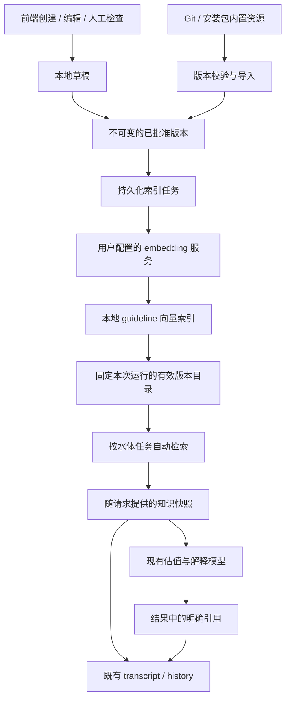
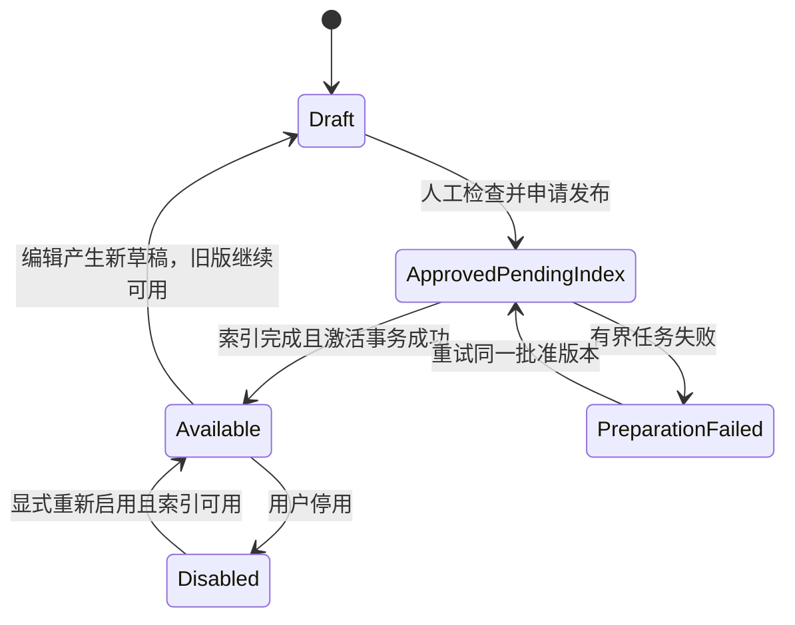

# Guideline Knowledge：专业推理参考库技术设计

日期：2026-10-20（Asia/Shanghai）

状态：产品决定已收敛，Milestone 0–9 已完成基线、领域/ports、数据库、内置导入、管理 API、embedding、持久化准备、run pin/session 检索、模型可选参考、typed 知识记录与结果/历史引用闭包。**前端及真实内容验收尚未完成，本文不是功能发布完成声明。** 决定依据见[讨论记录](guideline_design_discussion.md) D01–D14；本文规定功能与技术契约，[Implementation TODO](guideline_implementation_todo.md)是后续 coding agent 的唯一实施进度清单。

## 1. 目标与产品契约

为现有水体分析提供可检索的专业说明书。说明书保存现象背后的机制、成立条件、判断线索、替代解释及可参考的估值思路。系统自动选择有界内容，模型自主决定是否采用；说明书不成为必须执行的程序或新增的数值资格门槛。

| 项目 | 确定行为 |
| --- | --- |
| Demo 场景 | 下游 pH 的估计与原因解释；模型、索引和调用接口按通用指标/场景设计。 |
| 内容性质 | Advisory knowledge；缺资料时仍允许模型在既有契约内自行推理。 |
| 内置库 | 制作者维护、检查后的说明书随 Git/安装包分发，内容版本不可原地修改。 |
| 用户库 | 用户在前端创建说明书，保存在本地数据库，不自动提交 Git 或上传公共资料库。 |
| 编辑内置 | 保存为本地修改版本；发布后用于本机分析，程序更新保留本地修改，可显式恢复内置版本。 |
| 人工发布 | 草稿经过用户或指定人员检查后，才申请进入正式检索库；格式检查和 embedding 成功不代替人工检查。 |
| 出处 | 专业资料整理型说明书保留出处；用户自编内容可以没有外部出处，并标明来源性质。 |
| 检索 | 系统按问题、指标和场景选取候选，再用 embedding 做语义排序；不依赖模型主动搜索。 |
| 展示 | transcript 展示实际随请求提供的内容；结果解释可以引用模型明确采用的说明书，并查看内容及出处。 |
| 本地范围 | 内置资源可公开分发，用户内容仅由本地应用持久化；允许用户配置的模型服务处理检索文本和分析输入。 |
| 验收 | 完整检索/输入/引用/历史展示链路，加少量有实测对照的 pH 案例。 |

现有 scope、evidence allowlist、观测溯源、单位/聚合、结果来源和数值一致性校验继续生效。说明书不是 observation，不能满足 measurement sufficiency gate，不能把模型估计升级为 observed。

本轮规格不引入公共上传/共享平台、账号与多租户权限系统、脚本型 skill 执行、图数据库、自动联网补充资料或专业数值求解器。用户创建说明书的功能是内容编辑与发布，不授予任意工具或代码执行能力。

## 2. 现有实现依据与接入点

调查基线：`codex/runtime-smoke-fixes-20261014`，HEAD `0f2bfd4d79b80d80dfcaaec03d8c8c6ea6879b41`。实施前重新核对 HEAD 和工作树差异。

2026-10-20 的 Milestone 0 已在当时最新 `origin/main` / `6cedea4f1f21339dcd87ef5a3bbd2d49079ef799` 上复核，两者 tracked tree 一致；完整消费者与实际验证只维护在 [TODO 的 Milestone 0 完成记录](guideline_implementation_todo.md#milestone-0基线与完整接缝盘点)。M0 时 migration head 为 `20261020_01`，M2 增至 `20261020_02`，M6 无新增 DDL；后续迁移仍须以实施时实际 head 为准。

| 当前路径 | 已核实事实 | 本功能的改动责任 |
| --- | --- | --- |
| [planning_loop.py](../../backend/app/application/reasoning/planning_loop.py) | evidence planning 后调用 numeric estimator，随后 seal evidence。 | 在实际需要模型的路径中获取一次 session knowledge context；传入 planning 和 numeric 请求。 |
| [numeric_estimation.py](../../backend/app/application/reasoning/numeric_estimation.py) | 为 scheduled numeric task 单独建请求，目前只返回 value/range/confidence/rationale；已有 pH 提醒。 | 在估值之前提供参考，独立保存估值阶段的 guideline usage，不改变 numeric payload 的 measurement lineage 要求。 |
| [runner.py](../../backend/app/application/reasoning/runner.py) / [prompt_builder.py](../../backend/app/application/reasoning/prompt_builder.py) | reasoning batch、synthesis 与 model fit 分别构建；system rules 要求严格遵守。 | 独立 advisory block，知识预算计入完整请求；repair 复用原上下文。 |
| [embedding_contract.py](../../backend/app/application/transcript_memory/embedding_contract.py) / [openai_embeddings.py](../../backend/app/infrastructure/adapters/openai_embeddings.py) | 当前 adapter 先校验 `CanonicalCaseQueryV1`，不接受任意说明书。 | 新建 guideline document/query 契约；共享供应商传输和通用向量校验，保留历史 case 校验。 |
| [provider_bundle.py](../../backend/app/infrastructure/runtime/provider_bundle.py) | run 拥有固定 credential leases 与 provider adapters。 | 复用 run 级供应商生命周期，避免运行中凭据替换或泄露到知识记录。 |
| [transcripts/registry.py](../../backend/app/application/transcripts/registry.py) | typed content 注册同时管理引用、公开投影与读取。 | 注册新的知识记录，补齐引用提取、public projection、SSE 与 history closure。 |
| [working_context.py](../../backend/app/application/reasoning/working_context.py) | safe prompt payload 禁止原始 URL 等标记，summary 有独立长度限制。 | 知识正文用专用有界结构；source URL 留在出处元数据，通过 source IDs 关联，避免破坏原有校验。 |
| [schema.py](../../backend/app/infrastructure/persistence/schema.py) | 已有 PostgreSQL/pgvector、migration 和持久化幂等模式。 | 增加 guideline 命名空间的表与迁移，不把知识伪装成历史 RAG case。 |
| [upstream_projection.py](../../backend/app/application/evidence_tools/upstream_projection.py) / [source_reader.py](../../backend/app/application/transcript_memory/source_reader.py) | 下游 waterbody 和 M8 各自读取已保存结果及其引用闭包，存在独立的 scope/eligibility 检查。 | 新 usage refs 须覆盖这两类消费者，保留原 measurement lineage 与历史 case 资格，不把 guideline 正文投影成 evidence。 |
| [run_summary](../../backend/app/application/run_summary/) | 水体结果提交后构建汇总输入，单独调用汇总模型并允许一次 repair。 | 沿已保存有效引用传递相关快照；不在 run summary 重新全库检索，也不将水体 session 的零模型出口等同于整个 run 零调用。 |
| [DetailPanel.tsx](../../frontend/src/features/analysis/DetailPanel.tsx) | `visibleRecords` 限定可见类型，支持读取保存正文。 | 新增 provided knowledge card 与结果引用查看，覆盖实时与 history。 |
| [App.tsx](../../frontend/src/app/App.tsx) / [local_mutation.py](../../backend/app/api/http/local_mutation.py) | 现有应用为本地工作台，API mutation 受 Host/Origin/JSON 边界保护。 | 增加本地说明书页面和 CRUD/publish API，沿用该边界。 |

numeric request 自行构造，并保留 192,000 bytes 原输入上限；它不经过 `PromptBuilder`，该字节门禁也不是模型 token fit。M8 在实际调用前使用同一 `GuidelineModelContext` 检查最终序列化请求，覆盖 numeric、planning、batch、synthesis 与 repair。

## 3. 总体架构与责任



- `domain/guidelines`：内容、来源、不可变版本、profile、引用、状态及不变量。
- `application/guidelines`：authoring/review/publication、effective catalog、检索、上下文编排及引用解析。
- `ports`：repository、guideline embedding、bundled source、clock/cancellation；application 不导入 HTTP 或 SQLAlchemy。
- `infrastructure/guidelines`：内置资源读取、provider adapter、runtime/worker composition。
- `infrastructure/persistence`：SQL repository、事务、任务恢复和迁移。
- `api/http/guidelines` / `api/schemas/guidelines`：本地管理接口；分析检索继续在现有 workflow 内部发生。
- `frontend/features/guidelines`：列表、编辑、检查/发布和状态；共享只读 viewer 可供结果与 transcript 使用。

新增 `GuidelineRuntime` 负责内容/index 服务，注入现有 run provider bundle 和 waterbody runner。不得增加第二套分析 workflow、第三条 SSE 或模型可直接调用的任意数据库/URL 搜索接口。

## 4. 两类资料与本地覆盖

### 4.1 身份与内容权威

| origin | identity | 内容权威 | 分发 |
| --- | --- | --- | --- |
| `bundled` | 稳定 `bundle_key` + 制作者 content version；导入时映射稳定 UUID | 当前发行包的 manifest + Markdown；数据库保留不可变导入版本 | 随代码/安装包分发 |
| `local_custom` | 本机生成的 `guideline_id: UUIDv4` | 本地数据库草稿和发布版本 | 不自动出现在 Git 或公共库 |
| `local_override` | 独立本地 document identity，指向 `base_bundle_key`；有效 family root 为被修改内置项 | 本地数据库；每版记录 `based_on_version` 与 base digest | 与用户库相同 |

同一文档版本只有一个内容权威。对内置内容的 UI 修改不反写包文件；数据库中的 bundled 内容是由 package 校验导入的副本，不开放独立编辑。

内置包建议放在 `backend/app/infrastructure/guidelines/bundled/`，由 `manifest.json` 引用 `.md` 正文。manifest 固定 key、version、title、metadata、source refs、正文 SHA-256 和制作者检查记录。使用 JSON，首版不新增 YAML 依赖。打包时显式配置 package data；wheel 安装和源码运行都必须能读到相同资源。

M3 的资源格式为 `{"schema_version": 1, "documents": [...]}`；每条包含 `bundle_key`、正整数 `version`、包内相对 `.md` 路径 `body_resource`、`body_digest`、`content_digest`、`model_view_digest`、`metadata` 与完整 `GuidelineReview`。`metadata` 沿用内容字段但不拥有正文；正文先 NFC/LF 规范化，再以 UTF-8 SHA-256 校验，随后校验完整内容、已登记参数、安全 model view 及其 canonical digest。review 必须显式绑定稳定 document UUID 与 content digest，不能从正文或元数据自动补造。reader 使用 `importlib.resources`；version UUID 使用 UUIDv5 名称 `wateragents:guideline:bundle:{key}:version:{number}`。重复 JSON 字段、重复 key/version、路径越界、缺文件或校验失败使该资源集读取失败。

正式 `bundled/manifest.json` 当前为空；首批真实资料与制作者实际批准由 M11 完成。合成批准样本仅位于 `backend/tests/fixtures/guidelines/`。`BundledGuidelineImporter.import_all()` 将 reader 的批准版本交给 repository，原子保存不可变版本与 `import_bundled` pending operation，接入持久化准备队列；是否 available 仍以完成准备后的目录为准。资源错误作为 safe error report 返回，各 family 的数据库冲突分别报告，均不清空已有资料库。重复导入复用当前 receipt，不重置失败次数或替换手动 retry；新 base version 只 supersede 旧 base 准备任务，保留 local override 的 epoch/任务。新安装允许从发行版本号直接开始；旧包缺项不删除数据库内容，未曾导入的低版本不能逆转已有更高版本意图。M6 已在 runtime startup 调用导入入口并启动持久化 worker。

### 4.2 有效版本选择

每个 family root 在任一 catalog revision 下至多有一个有效版本：

1. root 被用户停用：不进入候选集。
2. 存在已发布、索引可用的 local override：选择本地修改版。
3. 否则选择该 root 最新已准备完成的 bundled 版。
4. local custom root 选择其已发布、索引可用版本。

草稿、人工检查尚未完成、索引未完成或失败的新版本不替代现有版本。不同 family 的知识由相关性与适用范围排序；来源为用户自编不意味着其结论被强制优先采信。

停用作用于 family，不暗中退回被用户替换或停用的内置内容。“恢复程序自带版本”是单独的显式操作，采用最新可用 bundled 版；保留本地修改历史。再次编辑已有 override 时，从其当前本地内容继续。

发行包新增版本不覆盖本地 override，也不自动合并正文。界面可显示“内置版本已更新”；用户可以查看、继续保留本地修改，或恢复默认。相同 bundle key/version 出现不同 digest 时报告资源版本冲突，不覆盖旧记录。

M3 的首次 `local_edit` 在 root revision CAS 下核对明确的 base version/digest，复制为独立 override draft（默认 `user_authored`，保留 source refs/base provenance，不复制审核资格）；已有 override 时返回当前本地 document，不再用发行正文覆盖。两条并发请求共享唯一 override identity，receipt 重放继续先于 CAS。有效目录只选择已完成准备的 active pointer：ready override 优先，否则 ready bundled/custom；pending/failed 不替换旧有效版，停用 root 始终排除整个 family。显式 restore 还核对目标为当前 generation 中最新已完成准备的 bundled 版本；只有向量但 operation 尚未完成的版本不能作为目标。恢复时清除 override 当前 active pointer，保留其草稿与全部不可变历史，后续发行更新继续选择内置内容；重新编辑并人工发布本地稿后才能再次激活 override。

## 5. 内容契约、来源与人工发布

### 5.1 `GuidelineContentV1`

| 字段 | 类型与约束 |
| --- | --- |
| `title` | 非空字符串，最多 160 字符 |
| `summary` | 非空字符串，最多 240 字符，用于列表和检索 |
| `parameter_keys` | 去重的 canonical `ParameterKey[]`；至少一个；支持注册表内任意指标，不把 pH 编进通用类型 |
| `related_parameter_keys` | 可空、去重的已登记指标数组，用于跨指标相关机制的候选匹配；不授予测量资格 |
| `scenario_tags` | 去重字符串数组，最多 12 项，每项最多 48 字符 |
| `keywords` | 最多 24 项，每项最多 64 字符；允许同义词与中英文术语 |
| `language` | `zh` / `en` / `mixed` |
| `source_kind` | `reference_derived` / `user_authored` |
| `body_markdown` | 非空；发布上限 6,000 UTF-8 bytes；草稿上限 24,000 bytes，发布时提示拆为独立完整主题 |
| `sources` | 最多 16 个结构化 source refs；`reference_derived` 至少一个；`user_authored` 可为空 |

草稿使用允许字段暂缺/为空的独立 draft schema；上表非空、出处和发布长度要求在检查/发布时生效。不能因尚未补齐内容而阻止用户保存草稿。

Milestone 1 的实现位于 `backend/app/domain/guidelines/`，ports 位于 `backend/app/ports/guidelines.py`。`GuidelineDraftV1` 与 `GuidelineDraftSourceRef` 允许未填写正文/标题或来源标题；`draft.publication_content(registry)` 独立执行完整字段、已登记 primary/related 参数与安全 projection 校验，返回 `GuidelineContentV1`，不会自动创建批准版本。`GuidelineVersionV1` 另要求显式 `GuidelineReview`，绑定当前 guideline ID 与 content digest；复制内置内容/来源不自动复制其审核资格。

`GuidelineSourceRef` 包含稳定 `source_id`、title、可选 HTTP(S) URL、可选章节/页码 locator、可选发布/访问日期。origin 与 source_kind 是不同维度：本地用户也可以整理有出处的资料；编辑内置内容默认标为用户修改，保留 base provenance，不能自动继承“原文已获专业复核”的含义。

工程字段上限：source ID 为 1–64 个 ASCII 字母/数字及 `._-`（首字符为字母/数字），source title/locator 最多 240 字符，URL 最多 2,048 字符且不允许 userinfo/凭据查询字段。相同 source ID 的相同 metadata 去重，冲突 metadata 拒绝；sources 按 ID 稳定排序。reviewer 标签最多 160 字符，非空检查说明最多 1,000 字符；审核信息必须明确提供，不由类型或 projection 自动生成。

编辑模板建议包含：机制解释、成立条件、可观察线索、替代解释/反例、估值注意事项。正文必须解释原因，不能只是阈值清单。人工检查负责内容完整性与逻辑；服务端验证结构和来源关联，不假称能自动证明科学正确性。

说明书以完整主题为检索/提供单元。首版不做任意 token 分块：过长内容由作者拆成各自包含前提、机制和例外的独立说明书。因果链路使用正文、列表或图示说明，无需图数据库。

### 5.2 Model projection

保存原始 Markdown 与 source metadata；另生成确定性的 `GuidelineModelViewV1`：title、summary、来源性质、正文解释、source IDs。模型输入不含 source URL、credential、provider 路由或管理接口信息。

正文中的链接/裸 URL 规范化为稳定的 source ID 占位；链接地址留在 source metadata，原文留在本地查看器。转换后进行独立长度和 safe-payload 校验；不截断正文、不删除机制文字来强行通过校验。正文含无法安全转换的内容时，发布检查返回具体字段错误。不得放宽所有历史 evidence summary 的 URL/secret 校验来迁就此功能。

当前纯 projection 为 `project_model_view(content)`：只将正文中已登记的 HTTP(S) URL 替换为 `[source:<id>]`，保留其余解释文字、Markdown 标签和条件/例外；支持中英文标点、自动链接与引用式链接。未登记 URL 返回 `body_markdown` 字段错误，由作者补齐 sources；同 URL 对应多个 source ref 时使用排序后最小的 source ID，完整来源仍留在原文内容快照。model view 的完整 canonical JSON 上限为 12,000 UTF-8 bytes；转换后过长或含不安全标记时拒绝发布，不截断。该界限独立于旧 summary 的 2,048 字符门禁。

模型只能据 guideline ID/alias 引用内容。点击出处由前端基于保存的 source metadata 构造 HTTP(S) 链接；不执行 Markdown HTML、脚本或任意 URL scheme。

### 5.3 Review 与 publication

本地用户可担任自己内容的检查人；首版不新增账号/RBAC 或双人审批。检查动作必须是明确的发布操作，而非保存草稿、向量生成成功或后台 worker 自动代为批准。

发布请求绑定 `expected_revision`、`content_digest`、`review_confirmed=true` 与本次检查说明。服务端生成检查时间和不可变 `version_id`；检查标签是本地操作审计信息，不是经过身份认证的专业资格。

content canonicalization 固定为 UTF-8、正文 CRLF/CR → LF、Unicode NFC、稳定 JSON key order；保留正文语义和大小写，排序/去重纯 metadata 集合。manifest hash 与数据库 content digest 使用同一规范，避免 Windows Git 换行转换改变版本身份。前端发布使用服务器保存 ACK 返回的 digest，不对尚未保存的脏编辑冒算批准 hash。

agent 整理的首批专业资料只生成草稿。内置包只有经制作者实际检查的版本才标为可分发的 approved 内容；实现 agent 不得伪造审核人或自动把未检查草稿纳入生产包。



状态图描述 UI/操作流程；批准版本正文不可变，编辑动作产生新草稿，不把旧版本正文改回可变状态。

## 6. 持久化与事务

复用现有 PostgreSQL 与 migration 系统，新增 guideline 命名空间。表名/字段为本设计规定的实施目标，迁移编号按实际实现时间及当前 Alembic head 分配。

| 表 | 主要字段与不变量 |
| --- | --- |
| `guideline_documents` | UUID identity、origin、family root、bundle key、draft content/digest、monotonic `revision`、active/pending pointers、root `activation_epoch`、disabled flag；override 对 base root 唯一。 |
| `guideline_versions` | 不可变 content/source/model-view snapshots、version ID/number、digest、人工检查记录、base provenance；唯一 document/version。 |
| `guideline_catalog_state` | 单例 monotonic revision、唯一 active guideline index generation；锁定 catalog mutation 的事务入口。 |
| `guideline_catalog_entries` | `family_root_id`、`version_id`、`valid_from_revision`、`valid_to_revision`；同一 revision 的同一 root 不得重叠。 |
| `guideline_index_generations` | 不可变 profile snapshot/digest，`building/active/retired/failed`；至多一个 active，至多一个 building。 |
| `guideline_embeddings` | 唯一 generation/version、canonical document digest、向量、维度；向量维度/profile 与所属 generation 一致。 |
| `guideline_operations` | 幂等请求 receipt、fingerprint、immutable accepted response、关联 document/version、操作状态、claim lease、attempt、safe error；发布/重建任务可重启恢复。状态为 `pending/running/succeeded/failed/superseded`，普通保存 receipt 可直接 succeeded。 |

索引是派生数据，不能代替内容版本。用户数据属于本地数据库；程序更新与资源导入不得清空用户表。首版不自动永久删除旧内容或 retired generation；清理策略必须另有显式依赖检查，历史知识快照不依赖当前 index 存活。

### 6.1 Publication transaction

1. 查找幂等 receipt；相同 key/fingerprint 重放原接受结果，不重新批准或创建版本。
2. 锁定 document，验证 `expected_revision`、draft digest、review confirmation；已有 pending publication 时返回冲突。
3. 原子保存不可变 approved version、publication operation、pending pointer 和新 document revision。返回 `202`，原有效版本不变。
4. worker 在事务外调用 embedding，再由 `complete_operation()` 在一个短事务内存向量并激活。取得锁后确认 attempt/owner/lease、pending version、activation epoch、active generation/profile 与批准内容 digest 仍匹配。
5. 同一事务关闭旧有效区间、写入新 catalog entry、增加 revision，并完成 operation/清除 pending pointer；任一步失败连同本次向量一起 rollback。
6. active generation 已变化时，为当前 generation 准备向量后再激活；旧任务不能将过期版本覆盖新的 pending/已激活版本。

锁序固定为 catalog state → document → operation/version；worker 不持数据库锁等待远程调用。操作重试不能生成第二个人工批准版本。

M2 持久化实现：迁移 `20261020_02` 显式创建七表及 `btree_gist` 扩展；GiST exclusion constraint 禁止同 family 的 revision 区间重叠。当前本地应用通过 catalog 单例行锁串行化 guideline 写事务，随后按 UUID 顺序锁定 family documents，再处理 operation/version；receipt 在 document CAS 之前重放。canonical fingerprint 包含操作种类、规范化请求正文和 expected revision，不包含服务端新分配的 operation/version ID 或审核时间；创建本地草稿也不绑定重试时重新分配的 document ID。数据库 trigger 禁止改写批准版本、向量和 accepted receipt，旧版本及 generation 不自动删除。

每个 operation 最多自动尝试三次，lease 为 1–3600 秒，前两次失败可分别等待 2/10 秒后再 claim。激活、向量写入与失败回写都在取得资源锁后读取当前 UTC clock，检查 attempt、owner、lease 截止时间和 root epoch；过期 lease 在下一次 claim 时回收，无需启动时重置 running 状态。显式重试为原批准 version 建立新 operation/receipt，旧 operation 标为 superseded，避免 attempt 重置造成旧 worker 再次获得完成资格。building generation 可回填经过完整 canonical/profile 验证的不可变向量，全部覆盖后才可按 catalog revision CAS 切换；publication 激活另须当前 active generation 中的向量就绪。

M6 的 [GuidelinePreparationWorker](../../backend/app/application/guidelines/worker.py) 共用 publication/rebuild 队列。publication 带非空 activation epoch；rebuild 带 generation ID、空 epoch，只为 document 已有 active version 派生向量，不改变发布指针或重新审核。显式 retry 保留此区分。失败重建将 generation 标为 failed，并使其余在途任务失效；相同配置不会轮询创建无限新 generation，用户 retry 原失败 operation 才恢复同一 generation。失败任务通过现有 document `preparation` / `preparation_failed` 返回 operation ref，供已有 retry API 使用，旧有效版本仍保留。改用另一合法 profile 或恢复原 active profile 时，废弃任务标为 superseded，不再显示旧重建错误，迟到响应无法写入。

document `revision` 用于编辑与管理 CAS；root `activation_epoch` 用于批准后的激活意图。保存新草稿只改变 revision，不使已经批准的不可变版本失去发布资格。显式停用、恢复或新的本地发布改变 activation epoch，使旧任务不能逆转用户后来的选择。内置包后台更新不覆盖 local override，也不能仅因新增 base version 就取消用户已批准的本地发布。

准备失败的 pending operation 可重试原版本；用户编辑并重新检查发布时，以新 activation epoch 将旧 operation 标为 superseded。无论哪种情况，都不能用后来修改的草稿内容替换原批准版本的正文。

### 6.2 Run catalog pinning

在现有 run 完成 query/topology context 准备、开始 waterbody 执行前，固定 active guideline generation/profile 和 catalog revision，写 `guideline_run_context`。查询 catalog entry 时使用该 revision 的有效区间。

该 run 的所有 waterbody session 使用同一目录/索引快照，各自按任务做检索。运行中发布、停用、恢复默认或索引切换只影响后续 run；不把运行内不同 session 暗中切到新的内容集合。旧 generation/向量需保留至相关运行结束，历史显示使用保存正文快照。

目录不可用不阻止 run 的正常创建/分析；运行的 guideline context 记录 unavailable，并沿原分析契约继续。已有数据库/分析本身故障仍按原服务错误语义处理。

M7 的 [GuidelineRunContext](../../backend/app/application/guidelines/retrieval.py) 在 `QueryTopologyWorkflow` 保存 topology 后、调用执行 stage 前取得一次 catalog，并以 `GuidelineRunPin` 固定 run ID、revision、generation/profile、策略版本及安全可用性状态；`WorkflowContext` 将它传到各 waterbody session。期望 profile 不兼容、缺配置或读取失败记录 unavailable，原执行 stage 继续。查询使用 pin 的 revision intervals 与 retained generation，不读取当前 disabled/active pointer；每轮发布、停用、恢复、切换只改变后续 run。M9 的 `save()` 在现有 workflow writer 保存一次 `guideline_run_context`，session 共用该引用；快照保留 revision、generation、profile ID/digest、策略版本和安全可用性，不序列化凭据或整库。

## 7. Embedding 与检索

### 7.1 Profile 与现有能力复用

默认使用当前 model catalog 的 embedding role 所指定的 provider/model、dimensions 与 max-input 设置作为期望配置，不在文档中写死型号。必须以中英文检索样例验证该配置满足需要。

新增 `GuidelineEmbeddingProfileV1`，identity 包含 provider、model、dimensions、cosine metric、document/query template version、text-contract version 及明确的 query/document instructions。不得复用历史 case profile ID 代表说明书向量。

`CanonicalGuidelineDocumentV1` / `CanonicalGuidelineQueryV1` 与 `GuidelineEmbeddingBatch` 使用独立契约。profile 使用 `guideline:sha256:...` 身份，digest 同时覆盖 max-input 与两种角色指令；canonical inputs 含各自 role kind、profile ID、模板/契约版本和显式指令，`require_profile()` 验证身份及角色匹配。document 由已验证 content/model view 和参数名称构建，canonical JSON 最多 24,000 UTF-8 bytes；query 保持 8,192 bytes 上限，显式 facts 最多 24 条、各 240 字符，超限直接拒绝，后续检索 builder 按 §7.3 整字段缩减。

提供 `GuidelineEmbeddingPort` 和 guideline 专用 canonical document/query inputs。将当前 adapter 的公共 HTTP 调用、输出 count/order/dimensions/finite/norm 校验抽为共享传输/校验基础；历史 `EmbeddingPort` 及 `CanonicalCaseQueryV1` 资格校验继续由其原调用路径负责。不要把说明书伪造成历史 case，也不要简单删除历史输入校验。

M5 的 `OpenAIGuidelineEmbeddingAdapter` 只接受 typed document/query，重验 schema/template、canonical bytes、profile identity 与角色指令，再经共享 `OpenAIEmbeddingTransport` / `embedding_validation` 发送和校验；旧 `OpenAIEmbeddingAdapter` 继续先执行原 case canonical 校验。说明书实际 provider input 固定为 `instructions + LF + canonical_text`，因此 `query:` / `passage:` 等可配置角色前缀位于文本开头，且完整内容与指令均绑定 profile。包含角色前缀的实际 document/query 输入分别不超过 24,000/8,192 UTF-8 bytes；每条实际输入同时用 UTF-8 字节数作为保守 token 上界，与 catalog 的 `max_input_tokens` 比较。这不是供应商 tokenizer 的精确计数，可能拒绝仍能被供应商接受的较长内容，超限不会截断条件/例外或派发请求。实际 tokenizer/检索质量由 M11 核对。

query/document 使用相同兼容 profile；若模型要求角色前缀，固定在 profile 模板中。更换 model、维度、模板或角色指令需重建相应 generation，不直接比较或混排不同 profile 的向量。

### 7.2 索引准备与更新

- 发布或内置资源导入时预计算 document vector；canonical text 包含 title、summary、parameter names、scenario/keywords 和完整 model-view body。
- 每次分析只计算必要的 query vector；不在每个时间窗重新嵌入资料库。
- worker 使用持久化 operation、有限并发、timeout/attempt 与重启后 lease 回收；失败保留人工批准版本和明确状态。
- 期望 embedding 配置变化时建立 building generation，覆盖当前有效 catalog 的全部版本。完成后在锁内核对 catalog revision；有变化先补齐/重试核对，再原子切换。切换前旧 active 继续服务。
- 没有 active generation、配置不兼容或 provider 不可用时，知识功能记录不可用；不阻断已有分析，不扫描未批准草稿兜底。

M6 的 `ensure_generation()` / `queue_generation()` 每轮检查期望 profile，分批补齐当前有效目录及各 document 保留的 active pointer，包括停用 family 和被 override 覆盖的 bundled base。后两者仍不进入检索；预备其向量使切换后的重新启用/恢复不会卡住。切换事务重新检查完整覆盖和 catalog revision，publication/disable/restore 期间的变化须先 reconcile。首次空库可先激活空 generation，再准备首个批准版本；迁移后已有 active pointer 的库先回填，未批准草稿不入队。publication 计算期间若 generation 改变，在同一 attempt deadline/credential lease 内最多重新计算一次，继续变化则按有限重试处理；旧 profile 结果不会提交到新 generation。

### 7.3 检索步骤

1. 从 run pin 获得 generation/profile/catalog revision；排除 draft、未激活版本及该 revision 下停用的 root。
2. 以 canonical parameters 和显式 `related_parameter_keys` metadata 获得候选；通用机制可声明相关指标，避免把 pH 与碱度、温度等相关知识机械隔离。scenario 是排序信号，未知情境不伪造为已知事实。
3. 构造 canonical query：用户问题、目标指标、inference mode、已知的水系/任务情境；不拼接 raw transcript、凭据、provider envelope 或无界观测数据。输入过长时优先保留结构化任务字段，整项省略超预算的可选自然语言字段并记录 `input_reduced`，不从正文中随意裁一段伪装完整问题。
4. 对该 profile 计算 query vector；PostgreSQL/pgvector 对授权候选做 exact cosine ranking。
5. 使用最低相似度、去重、稳定 tie-break、top-k 与上下文预算选取完整说明书。相同 family 只返回其有效版本。
6. 保留 retrieval 状态、选中内容和实际请求子集。相似度只用于相关性，不提升 confidence、风险等级或 measurement eligibility。

首版稳定排序为 similarity DESC、family root UUID ASC、version UUID ASC；不按用户来源或内置来源直接赋科学可信度。无关联候选或低于阈值时允许空结果。

M7 repository 的 `retrieval_counts()` 先按固定目录及主/related 指标检查候选，区分 empty-library/no-candidate；此时零 embedding。`rank_guidelines()` 在 materialized 授权候选内以 pgvector exact cosine 排序，执行 cutoff、family 去重及 top-k；拒绝不一致的 generation/profile、维度、向量范数或 canonical digest，并重新验证返回的批准版本/model view。scenario 仅进入语义 query，不授予候选资格。

`build_guideline_query()` 只采用验证后的问题、canonical 指标、mode、agent/target COMID 和拓扑直接上游数；可选问题过长或包含不安全内容时整项省略，记录 `input_reduced`，结构化字段优先。包括角色前缀的实际输入仍受 8,192 bytes 与该 profile 的保守 max-input 约束，无法容纳必需字段则 unavailable。

每个实际 Agent session 拥有独立 `GuidelineSessionKnowledge.get_or_load()`：并发共享一次任务，取消单个等待者不重发请求；缓存只绑定该 run/session/query/context/profile。整次检索（SQL、一次 query embedding、ranking）不超过 3 秒且受剩余 session deadline 约束，无在线重试；取消会回收在途任务，session finally 关闭并释放缓存。zero-model 分支不创建查询任务。M8 的 `GuidelineModelContext` 在首次真实 planning/numeric 请求前加载，使用既有实际模型 size estimator 对最终请求整份裁剪，保留 evidence/output 预算；M9 已通过既有 writer 持久化 retrieval/delivery/usage；仅实际进入模型端口才记录 delivery。

### 7.4 初始工程参数

这些是实现起始默认值，必须在对应策略对象中单点定义。真实检索样例可促使调整并记录策略版本；下列数值不是已验证的最优参数。

默认值与配置校验集中在 [GuidelinePolicy](../../backend/app/domain/guidelines/policy.py)，通过部署环境变量 `WATERAGENTS_GUIDELINE_POLICY` 的 JSON 对象覆盖，例如 `{"query_instructions":"query: ","document_instructions":"passage: ","worker_max_concurrency":1}`；未提供字段沿用默认值，不写入用户内容。top-k、知识 token budget 和在线 timeout 分别不超过 3、3,072、3 秒；自动 attempts 固定 3，退避固定 2/10 秒，在线只请求一次；repository、operation model 与 M6 worker 使用同一策略定义约束。

| 参数 | 首版默认 |
| --- | --- |
| 每 session 基础检索次数 | 1；在首次实际需要模型时惰性执行，相关 phase 复用 |
| 返回说明书数 | 最多 3 份完整文档 |
| `semantic_min_similarity` | 初始 0.35，使用所选模型的标注检索案例核对/校准 |
| guideline prompt budget | 每请求最多估计 3,072 input tokens，且不超过剩余模型容量；保留原 evidence/output 预算 |
| query text | 最多 8,192 UTF-8 bytes，按固定字段预算构造；不截断任意用户正文来制造不同含义 |
| 单次在线 retrieval deadline | 最多 3 秒，并受现有 session 剩余 deadline 约束；默认不在线重试 |
| worker 并发 | 2，单次 provider timeout 20 秒，attempt 上限 3；有限退避 2 秒、10 秒 |
| 每文档 source refs | 最多 16；每 source URL 最多 2,048 字符 |
| 管理列表 | 默认 20 条，最大 50 条，keyset cursor |

所有实际请求使用现有 model size estimator 对最终序列化内容测量。超预算按相关性从低到高移除整份 guideline，不截断其前提/例外；若全部移除，记录 budget-limited，分析照常继续。不能用字节数上限替代模型 token fit。

## 8. 模型调用接入与引用

### 8.1 调用时点

在 `GuidelineRunContext` 下提供 session-scoped `get_or_load()`。首次 evidence-planning 请求准备前加载；若现有流程没有 planning 调用而直接做 numeric estimation，则在首个 numeric 请求准备前加载。缓存和取消共享 session lifecycle。

已有 zero-model、已取消或 deadline 已耗尽路径不因本功能新增 embedding 或 reasoning 调用。不要仅据一个 handoff 标记猜测后面不会估值；以现有实际调度路径与请求入口测试证明。

planning、numeric、batch reasoning 各自获得同一 session selection 的适用子集；synthesis 可以读已有有效结果携带的引用及其相关快照，不在汇总时重新发起全库搜索。repair 保持原 operation scope 与知识子集。

知识放在独立 `advisory_knowledge` 输入块。system policy 只说明其来源角色、可选采用和引用规则，不把正文转换为必须遵循的 bracketed rules。正文中的建议不得修改工具 roster、scope、模型 role、输出 identity 或服务端数值规则。

M8 的 [GuidelineModelContext](../../backend/app/application/guidelines/model_context.py) 由 `M6RunnerService.build_runner()` 按 session 创建，planning loop、既有 numeric estimator 与 validation exchange 共用同一实例。每个 operation 从固定 selection 按主/related 指标取适用完整 model view，以独立 user message 附加；系统规则不含知识正文。size estimator 接收实际 request 与 response shape 的 canonical bytes，检查知识增量、context/output tokens 和既有序列化上限；原请求已超限时不派发。初始请求空间不足时整份移除低排名文档，全移除为 budget-limited；repair 必须保留原 alias/正文子集，无法容纳时按原 repair failure 结束。

### 8.2 Model output 与独立 usage 记录

为实际产生数值或解释的 response schema 增加可空数组 `guideline_refs`，值为本次请求提供的稳定 alias，M8 使用 `G<rank>_<operation UUID hex>`，避免另一 operation 的同排名 alias 被误认。repair 明确沿用原 alias/正文。模型没有采用资料时返回空数组合法；不要求逐一解释未采用项。

M8 的 [citation_resolver.py](../../backend/app/application/guidelines/citation_resolver.py) 在原严格 JSON 解析后只清理非法 guideline refs，保留其他字段的严格校验；warning 仅包含固定安全事件/code。numeric response、cell、window、overall 和 analysis step 的 nullable refs 作为内部 metadata 保留，排除于科学模型的 dump/digest。有效引用解析成 operation-local 不可变版本绑定与独立 `GuidelineOperationUsage` sidecar；numeric 绑定 task/window，并沿 `NumericDerivedPayload.model_operation_id` 和 task ID 关联原估值，未给该 payload 添加字段。synthesis 只读取已验证 cell 引用及所选 evidence 的 numeric/转换依赖链，不取未选用候选，也不重新检索。

`GuidelineRequestSelection` 表示请求构造快照。M9 将已解析的 sidecar 绑定到实际保存的 typed delivery 和 model response，再生成 `GuidelineCitationV1` 与 result usage；仅构造 request 不生成 delivery，也不制造 transcript item IDs。既有 request/validation audit 保留实际附带 advisory 的请求。

server 把有效 alias 解析为 `GuidelineCitationV1`：delivery item ref、guideline/family identity、immutable version ID、origin、source_kind 和引用来源 operation/phase。模型不能自行构造版本、URL 或 transcript item identity。

采用独立 typed usage records 保存引用，不为本功能扩展每一种观测/数值 payload：

- numeric response 校验后保存 `guideline_usage`，绑定 operation、numeric task/window。`NumericDerivedPayload` 已有 `model_operation_id`，用它关联估值的 usage；数值/范围/measurement anchors 按原路径保存。
- cell/batch/synthesis 输出中的 `guideline_refs` 作为内部 draft metadata 解析；保存其对应 cell、analysis step、window 或 overall target 的 usage binding。
- 正式 result assembler 根据最终采用的 evidence lineage 和已验证 drafts，生成 `result_guideline_usage`；通过现有 `analysis_detail.transcript_item_refs` 把该记录接入结果引用闭包。
- result-level usage 包含 `result_id` 和目标 key，但不反向引用尚未写入的 result transcript item，避免循环引用。
- 只有最终结果实际使用的 numeric evidence 才投射其估值 usage；不能把未被选用的估值候选或其他 cell 的引用自动加到结果。
- viewer 保留 phase provenance，区分“估值环节引用”和“解释环节引用”；汇总沿用已保存引用不表示汇总模型重新采用全部原文。

`InferenceResult`、`TimeWindowResult` 和 `NumericDerivedPayload` 的既有数值结构不因知识引用新增重复的科学事实字段。新 citation/usage 有自己的 typed schema；对旧记录不合成引用。

调整仍需覆盖 response schema builders、parser、draft metadata、validator/assembler、typed registry、API projection、frontend types/reader 及 M8 source closure。model request 可用既有 messages 保存新的 advisory block，digest 覆盖其实际字节；delivery 关联对应 request item 和 operation，不必把新字段硬塞入所有旧 request schema。

如实现中确实需要改变已有持久化 content schema，保留其旧版读定义、canonical hash/digest 和 history 解析；新生产写单一当前 schema，不原地重写旧 JSON，也不引入两个并行的生产分析路径。

仅 guideline alias 非法时：丢弃非法引用、保存 safe warning，不生成可点击的虚假出处；不要改写已通过校验的数值或把所有 provided 文档补成 adopted。原有 evidence、数值、identity 和 scope 错误仍按原严格 validator/repair 契约处理。模型自由推理不等于引用可以伪造。

## 9. Transcript、引用闭包与历史

新增 typed content，均默认 `rag_eligible=false`：

| content type | scope / 内容 |
| --- | --- |
| `guideline_run_context` | run scope；固定 catalog revision、generation/profile、策略版本、可用性与安全状态；不内联整库。 |
| `guideline_retrieval` | waterbody session scope；query digest、匹配条件、排名/相似度、检索状态、选择的版本与有界 model-view snapshots。 |
| `guideline_delivery` | session scope；实际 model operation/phase、对应 retrieval ref、最终随请求提供的 alias/版本/正文子集、预算裁剪情况与提交状态。 |
| `guideline_usage` | session scope；模型明确返回且通过校验的 citation，绑定 operation、delivery、numeric task/cell/解释 target。 |
| `result_guideline_usage` | session scope；server 从正式结果采用的数值 lineage 和有效 drafts 构造的引用映射，引用原 usage records，并由结果的既有 transcript refs 关联。 |

M9 的 [transcript_models.py](../../backend/app/application/guidelines/transcript_models.py) 定义上述五类 V1；[transcript.py](../../backend/app/application/guidelines/transcript.py) 经 `ReasoningTranscriptStore` / `WorkflowOperations` 调用同一 registry、buffer 和持久化 writer。`TranscriptRecordingWaterbodyModelPort` 在现有 cancellation commit section 内保存 request/delivery 后进入原模型 delegate，供应商异常仍由既有 response 状态表达，不自动生成 usage。run SSE 保留状态快照，session SSE 传递 typed transcript items，原内容 API 可读取完整快照；没有新增第三层 SSE。

[transcript_validation.py](../../backend/app/application/guidelines/transcript_validation.py) 在写入和历史读取时核对 run/session/operation、实际 advisory 字节对应的 alias/model-view digest、检索版本与引用版本、response 完成状态和 target。知识边只引用更早的 typed items，拒绝循环、错误 owner/version/operation；非法知识记录不通过完整内容 API 展示。run context 保存 profile identity/digest，避免把无关配置或敏感字段带入公开记录。原文、sources 和 model view 保存在批准版本快照中，历史读取不依赖管理库当前 active 内容。

既有 result assembler 完成科学结果后，`GuidelineModelContext.attach_result_usage()` 沿正式 point 的 evidence/数值输入/转换依赖投射 operation usages，数值引用同时匹配 operation 与 task；cell/window 必须一致，step 使用零基 index，overall 使用固定 key。result usage 先保存，再经已有 `analysis_detail.transcript_item_refs` 关联；不反向引用未来 result item。知识记录被 writer 拒绝时停止该路径，传播 `GuidelineTranscriptWriteError`，不把存储错误吞成 numeric task failure 或模型协议错误。

`TranscriptRAGCaseSourceReader` 验证新引用闭包；既有 eligibility 与 projection 保持原科学字段及 canonical/hash 语义，guideline 记录不成为 historical case，不自动索引原文。M9 验证覆盖实际 HTTP SSE、PostgreSQL 快照重启和 history API；管理页与交互式引用 viewer 由 M10 完成。

usage target keys 由 server 从已验证任务/结果建立：numeric task 使用既有 task ID，cell/window 使用既有 cell/window ID；analysis step 使用正式 steps 数组的零基 index，overall 使用固定 `overall`。operation-level binding 和 result-level mapping 分开，不能把一次未采用的候选估值仅凭同参数名称映射到结果。

`guideline_delivery` 的正文须可独立重建实际知识输入，包含来源性质、原说明书快照/查看引用、model-view 正文、sources 和 digests。相同版本允许在同一 session 复用已保存内容引用，但 history closure 必须可解析。

只有实际进入 model port 的请求才记录 delivery 提交；仅检索完成或构建 request 对象不标为“已提供”。提交不证明供应商成功处理，更不证明模型采用。发生 transport failure 时，关联既有 request/response 状态，界面使用“随请求提交 / 请求失败”等准确表述。

delivery 引用既有 model request item、retrieval 和 run context；usage 引用 delivery；result usage 引用其实际依赖的 operation usage。新记录的 registry reference extractors 提取完整闭包。结果 viewer 使用的 `GuidelineCitationV1` 必须回到当前 run 合法的 delivery snapshot；numeric 引用保留原 operation provenance。不得引用另一个 run 的管理库当前版本来冒充本次提供内容。

公开 projection 只含本地操作者需要查看的说明书内容、出处和安全错误；不包含 provider credentials、完整 provider response 或后台内部异常。管理库当前内容入口与“查看本次引用内容”入口分开：后者始终读运行快照，即使文档被编辑、停用、恢复默认或新内置包替换。

usage 的正文优先保存引用和 target binding，不重复复制知识正文；查看器经 registry closure 读取 delivery/retrieval 中的不可变快照。result usage 的 target key 必须属于正式结果的现有 cell/step/window/overall 集合，不能让模型通过 guideline_refs 创造新的 cell 或额外结果。

M8 继续只管理既有 historical case 语义。新增知识记录不自动进入历史 RAG；关联 guideline usage 的 inference result 在历史投影中仍保持原 source/confidence/eligibility，不能因有专业或用户说明书引用就获得更强 evidence 资格。更新其 source-closure reader 和投影测试，避免新引用导致历史索引失效或夹带整份用户说明书。

## 10. 本地管理 API 契约

路由挂载到既有 `/api/`，所有 mutation 复用 LocalMutationGuardMiddleware、JSON 校验、安全错误与 request ID。响应 `Cache-Control: no-store`。首版不实现身份认证或跨用户共享；“用户库”表示当前本地应用数据库中的用户内容。

### 10.1 接口

| Method / path | 请求与结果 |
| --- | --- |
| `GET /api/guidelines` | `source=all/bundled/mine`、`state`、可选标题/关键词查询 `q`、`limit`、`cursor`；返回管理列表、有效版本和状态。管理列表查询不调用 embedding。 |
| `POST /api/guidelines` | 创建 local custom draft；body 为允许不完整的 draft content，返回 `201` 和 document/revision。客户端不能设置 bundled origin 或批准状态。 |
| `GET /api/guidelines/{document_id}` | 返回 origin、draft/revision、active/pending versions、base provenance 和是否存在新版内置内容。 |
| `POST /api/guidelines/{bundled_id}/local-edit` | 绑定所见 base version/revision，创建本地 override draft；已有 override 时返回其当前内容，不重新覆盖。 |
| `PUT /api/guidelines/{editable_id}/draft` | 完整替换 draft content，携带 `expected_revision`；仅 local custom/override 可编辑。 |
| `POST /api/guidelines/{editable_id}/publish` | `expected_revision`、`content_digest`、`review_confirmed`、显式 `reviewer` / `review_note`；返回 `202` 和稳定 operation ref。 |
| `POST /api/guidelines/{family_root_id}/set-enabled` | `expected_revision`、`enabled`；改变以后 run 的有效目录。未准备好索引时不能显示为可用于分析。 |
| `POST /api/guidelines/{bundled_id}/restore-bundled` | 校验所见 root revision、明确的目标 bundled version；恢复该最新可用内置版本，本地修改历史保留。 |
| `GET /api/guidelines/operations/{operation_id}` | 返回准备/成功/失败/superseded 状态与安全错误；用于 UI polling 和不确定响应的对账。 |
| `POST /api/guidelines/operations/{operation_id}/retry` | 对仍有效且已人工批准的失败版本重试准备，不重新生成版本或伪造审核。 |
| `GET /api/guidelines/{document_id}/versions/{version_id}` | 读取不可变管理库版本；不是历史运行引用的唯一读取渠道。 |

静态 `/operations/...` 路由须避免与 `{document_id}` 捕获冲突。历史内容继续通过既有 run/session transcript/content API 读取，引用不依赖管理 API 的当前 active 指针。

M4 的 create body 直接使用 `GuidelineDraftV1`；save body 为 `{expected_revision, draft}`。mutation 返回不可变 `GuidelineMutationReceipt`（`document_id`、`accepted_revision`、`content_digest`、`version_id`、`operation_id` 按操作提供）；所有重放保留原 body/status，当前状态另行 GET。document GET 返回服务端 `draft_digest`、`has_unpublished_changes`、own active/pending 完整版本、family effective version ID、最新内置版本、preparation operation 及管理状态。状态为 `draft/preparing/available/preparation_failed/disabled/unavailable`，描述资料/准备状态；旧有效版与尚未发布的草稿分别保留，列表也提供未发布修改标记，不把编辑后的正文当作已激活正文。

列表使用 PostgreSQL 本地标题/关键词文字匹配；`q` 最多 160 字符，`limit` 为 1–50（默认 20），按 document UUID 升序分页。cursor 最多 512 字符，编码格式版本、最后 UUID 和 source/state/规范化 q 的 digest，不能跨筛选条件复用。列表不返回草稿/版本正文，不派发 embedding/model 请求。生产管理服务复用应用现有数据库连接；自定义 store 环境需显式注入 guideline repository，否则返回 `503 guideline_storage_unavailable`，不创建另一套临时资料库。全部 guideline 响应（含校验/安全拒绝/不存在/未知异常）由既有 RequestContextMiddleware 添加 no-store 与 request ID。

### 10.2 幂等、并发与不确定响应

所有 mutation 使用 UUIDv4 `Idempotency-Key`，服务端记录 canonical request fingerprint。相同 key/body 返回已接受的 immutable response 或 operation ref；相同 key 不同 body 返回 `409 idempotency_conflict`。

editor、publish、enable/restore 都使用相应 document/root `expected_revision`。冲突返回 `409 guideline_revision_conflict` 和可安全展示的最新 revision/snapshot，不能自动覆盖用户本地编辑。receipt lookup 必须早于 CAS 检查，避免成功提交的重试被误判为新冲突。

M4 的 publish fingerprint 绑定 document ID、expected revision、已保存 content digest 和显式确认/reviewer/note，排除服务端分配的版本 ID/审核时间；先查 receipt，再读取当前草稿，因此后续编辑不会使已接受发布的重放变成另一份请求。服务端从已保存内容建立批准版本，并在 SQL 短事务中再次验证 revision/digest；客户端不能提交 origin、版本 ID 或完整审核记录来代替人工发布。409 error envelope 增加可选 `current_document`，携带安全的最新管理快照；accepted 后的准备失败通过 operation 报告，旧 receipt 仍重放原 202。M6 worker 消费 durable pending，准备成功后才成为有效内容。

创建 override、异步发布、停用和恢复都改变 document/root 相关 revision 或 activation token。worker 在激活时校验 token；用户后来的停用、恢复或新发布会使旧任务 `superseded`，旧 worker 不得反向恢复已经被替换的内容。

网络超时、响应丢失或 JSON 无效意味着结果不确定。前端保留编辑内容与原 key，先查询 operation/document 或重放同 key 对账；不盲目新建文档、再次发布或丢弃草稿。迟到的保存 ACK 只确认它所提交的 edit version，不能清掉用户之后输入的文本。

### 10.3 状态码与错误

- `400/422`：字段、source-kind/出处要求、长度、canonical projection、cursor 或 approval digest 不合法。
- `403`：既有本地 mutation 边界拒绝；不得绕开该校验。
- `404`：本地 document/version/operation 不存在。
- `409`：revision、幂等 key/body、pending publication、bundle version/digest 或 activation 冲突。
- `503`：管理存储暂不可用。发布接受后的 embedding 失败通过 operation/index 状态报告，不伪装成保存失败。

建议 safe error codes：`guideline_revision_conflict`、`guideline_review_required`、`guideline_content_invalid`、`guideline_source_required`、`guideline_publication_pending`、`guideline_bundle_conflict`、`guideline_preparation_failed`。错误不回传原始 provider envelope 或密钥。

## 11. 前端交互

新增 `/guidelines` 页面及主导航“说明书”。现有分析页面继续承担结果、Agent/transcript 和引用查看；不把说明书管理塞进一次分析的必经步骤。

### 11.1 列表与编辑

- “程序自带”与“我的说明书”两个来源视图；本地修改的内置项清楚标为“已在本机修改”。
- 创建说明书：标题、简介、适用指标/场景、正文、可选出处；选择“整理专业资料”时出处必填，“自己编写”时可为空。
- 模板提示机制、条件、判断线索和例外；向用户显示自然语言字段，不要求填写 profile、digest、canonical text 或向量。
- 保存草稿独立于发布；编辑内置项时说明修改仅作用于本机，并基于当前有效内容创建本地稿。
- 检查/发布视图展示实际待发布内容、来源性质、出处、基于的内置版本和检查确认。按钮语义为“检查并发布”，不能由 autosave 触发。
- 状态用“草稿 / 正在准备 / 可用于分析 / 准备失败 / 已停用”等用户用语；失败保留内容和重试入口。
- 内置更新不覆盖本地修改；“恢复程序自带版本”展示将采用哪一版和会保留本地修改记录。

编辑器状态至少区分 loaded revision、submitted edit version、current edit version 与不确定的 mutation。退出未保存编辑须保留/提醒；后台请求完成不把脏编辑重置为服务器旧状态。

### 11.2 Transcript 与结果 viewer

transcript card 展示该次请求实际附带的说明书标题/版本、来源标签、提交状态，并可展开保存正文与出处。候选/预算移除项若展示，分别标为检索候选或未提供，不计入提供名单。

结果中的已验证 guideline citation 提供“查看参考说明书”入口，展示该次运行的版本和来源 phase。没有引用时不自动列出 provided 文档作为采用依据。没有外部出处的 user-authored 内容显示“用户编写，无外部出处”；不是内容错误。

viewer 优先复用安全的正文查看交互；若引入 Markdown renderer，必须禁用原始 HTML 和脚本、限制链接 scheme，并增加相应测试。管理库编辑路由不能替代 history snapshot viewer。

对现有 `referencedItems` 按 content type 分类；guideline snapshots/usage 不显示为历史水体 inference 或 measurement evidence。result viewer 根据 result ID 和既有引用闭包取得 `result_guideline_usage`，按目标 cell/解释 target 展示对应引用。

## 12. 失败、取消、配置与隔离

| 情境 | 规定行为 |
| --- | --- |
| 资料库为空 | `empty_library`；不调用 query embedding，模型按原路径分析。 |
| 没有适用候选/相关性不足 | `no_match`；不塞入低相关内容凑数。 |
| embedding/key/model/index 不可用 | `unavailable` + safe reason；记录后继续已有分析；不改 risk/availability 为技术失败。 |
| 预算移除了全部知识 | `budget_limited`；不给模型伪造提供记录。 |
| publication 准备失败 | 已批准版本留存并可重试，旧 effective version 继续可用。 |
| 内置 manifest/hash/version 冲突 | 拒绝冲突资源，记录可见的库准备错误，保留已有有效版本和用户内容；不因资源导入失败清空本地库。 |
| 分析取消或 deadline 已到 | 取消知识查询/embedding，不在 terminal session 之后追加模型任务或公开 delivery。 |
| 说明书有不同观点 | 保留各自条件和来源，模型自主权衡；不按 cosine score 宣称其中一条科学上正确。 |
| 更新配置/内置文件 | 新 generation/version 准备完成后才影响新 run；旧 run pin 不变。 |
| transcript writer 拒绝新知识记录 | 不向模型注入无法建立合法引用的内容，记录可用安全状态；已有 persistence failure 契约照常处理。 |

guideline 与 M8 historical memory 是不同功能。`stateless` 或 `WATERAGENTS_MEMORY_ENABLED=false` 不自动禁用已发布的专业/用户说明书；guideline 自身依当前本地库和 embedding readiness 决定可用性。

后台 publication worker 在每次 attempt 开始获取自己的 credential lease；run 查询/分析复用 run-owned lease。替换密钥不把一个正在执行的 operation 改成混合凭据，也不把 lease 内容写入知识版本、manifest、transcript 或日志。

M5 的 [GuidelineRuntime](../../backend/app/infrastructure/runtime/guidelines.py) 在生产 composition 中复用应用 HTTP pool；`RunProviderBundle` 从既有 OpenAI lease 构造独立说明书 adapter，bind/release 使用自己的 run registry，不读取 memory mode 或 M8 开关。后台通过 `embedding_for_attempt()` 每次获取一次新 lease，已返回 adapter 持有该次凭据快照。online/attempt adapter 分别把 deadline 限制为剩余 session 时间与 3/20 秒策略的较小值，不隐式重试。缺失 profile、unsupported provider 或缺少 pool 仅记录安全配置不可用；缺凭据在 attempt 边界报告安全鉴权失败。统一 `guideline_embedding_failure()` 映射安全错误/可重试性，不保存 provider diagnostics。M6 已接入 worker/generation，M7 已接入 run pin/readiness 与 session 惰性检索，未把 M8 historical memory generation 当作说明书索引。

M6 startup 先导入批准资源，再启动每秒轮询的 worker；默认并发 2，整个 attempt 有 20 秒上限，lease 至少 60 秒且大于 attempt 加两次 DB operation timeout。合法 profile 缺凭据时仍能初始化 generation，准备操作安全失败；补密钥、重启及显式 retry 继续原批准版本。配置无效时保留 durable pending，修正配置并重启后恢复。shutdown 先停止领取/派发，再按既有 `shutdown_save_grace_seconds` 有界等待，超时取消并回收全部子任务，然后应用才关闭共享 HTTP/engine。未完成 running 保留租约，重启后过期回收；不续派、不自动 purge 旧 generations/versions。

查询返回的知识须通过完整的版本/profile/source 校验；取消和 timeout 使用既有 clock/cancellation 基础。publication/index worker 是有界后台工作，不新增常驻模型会话或无界自动恢复链。

### 12.1 本地与模型处理范围

应用不提供用户说明书的公共上传、遥测正文采集或自动 Git 写入。用户库属于本地数据库及其由用户自行管理的备份；内置 release files 与用户数据的路径/导出责任分开。

已确认允许向用户配置的模型服务发送必要内容：文档建索引时发送 canonical document text，查询时发送 canonical query，推理时发送选中的 model-view 正文。界面不宣称“所有内容绝不离开设备”。供应商处理范围以用户配置的服务为准，本功能不擅自切换供应商或使用额外公共知识平台。

## 13. 首批 pH 内容计划与调查依据

首批建议整理以下独立、可人工检查的草稿。每份都包含完整解释、成立条件、可检查证据、反例/替代解释和来源；不是强制执行的数值算法。

| 主题 | 可借鉴第一方资料 | 内容边界 |
| --- | --- | --- |
| 上下游 pH 与混合估计的限制 | [USGS PHREEQC MIX](https://water.usgs.gov/water-resources/software/PHREEQC/documentation/phreeqc3-html/phreeqc3-27.htm) | 混合涉及溶液组成与平衡；该资料不是仅给 pH/流量就能准确计算下游值的公式。 |
| 酸性输入与缓冲能力 | [USGS Alkalinity and Water](https://www.usgs.gov/water-science-school/science/alkalinity-and-water) | 碱度影响酸性输入下的 pH 响应；未知碱度是缺口，不自动意味着变化大或小。 |
| 营养物质、光照、光合作用与呼吸 | [EPA CADDIS Nutrients](https://www.epa.gov/caddis/nutrients) | 不同条件和竞争过程可能导致不同 pH/溶解氧现象；一般机理不证明本地已经发生该过程。 |
| 从现象提出和比较原因 | [EPA Conceptual Diagrams](https://www.epa.gov/caddis/about-conceptual-diagrams)、[Data Analysis](https://www.epa.gov/caddis/getting-started-data-analysis) | 用可能的因果路径组织证据与缺口；箭头表示可能关系，不是无条件因果保证。 |

此处是撰写计划与资料依据，**没有实际发布、人工批准或验证这四份说明书**。用户自编内容可以没有这些外部来源。后续增加其他指标遵循同一内容/来源/版本契约。

embedding 检索原理参考 [Sentence Transformers Semantic Search](https://www.sbert.net/examples/sentence_transformer/applications/semantic-search/README.html)：查询和文档使用兼容向量空间匹配相关内容。该引用不表示选定 Sentence Transformers 库或某个权重；当前工程优先复用已配置的 embedding 供应商能力。

## 14. 验收与测试规格

### 14.1 必须覆盖的行为

| 类别 | 有意义的验收案例 |
| --- | --- |
| 内容/来源 | 参考整理型缺出处不能发布；用户自编无出处可发布；无人工确认不能从 draft 进入索引队列。 |
| 两类库 | 内置包可重复导入且不覆盖用户内容；编辑内置不写 package；override 发布后同 family 仅返回一版。 |
| 更新/恢复 | 新 bundled 版到达时本地修改保留；恢复默认采用明确版本；停用不暗中回退原版。 |
| CAS/幂等 | 同 key 重试不生成重复 document/version；相同 key 不同 body 拒绝；迟到 ACK 不清除新编辑。 |
| Publication race | 人工确认后编辑草稿不会改动正在准备的批准版本；旧 worker 在停用/恢复或新 activation token 后不能重新激活旧内容。保留该实际 interleaving。 |
| Index race | generation 切换与 publication 同时发生时不混用 profile；catalog 在重建时变化需补齐后再切换。 |
| 检索 | 中英文/同义提问能命中标注的相关说明书；无关内容不因凑 top-k 被提供；跨指标相关知识依显式 metadata 保留。 |
| 模型输入 | 第一次 numeric estimation 之前已具备相关知识；没有 planning 调用的路径也覆盖；零模型/取消路径不额外调用 provider。 |
| 预算 | 知识纳入最终 model fit；按完整文档裁剪，provided 名单与实际 payload 一致。 |
| 引用 | 空引用合法；未知 alias 不变成可点击出处；估值阶段引用能追溯到原 delivery；不创建 observed 资格。 |
| Transcript/history | 只构建未提交的请求不显示“已提供”；实时与保存记录一致；更新/停用后旧引用仍打开当时内容。 |
| 独立性 | memory disabled/stateless 下 guideline 仍可用；说明书不进入 observation gate 或 M8 knowledge source 的旁路。 |
| 前端 | 创建、自编无出处、编辑内置、检查发布、准备失败重试、停用恢复、引用查看；本地编辑并发与不确定响应。 |
| 安全边界 | 新 mutation 同样受本地 Origin/Host 保护；source URLs 不进入旧 safe summary 路径；HTML/链接不能执行脚本。 |

### 14.2 pH 实测对照

首版目标为 **3–5 个**可比较案例，至少包含一个上游参考较完整的场景和一个缺少部分解释信息的场景。实施 agent 先只读调查 USGS 等数据能否支持目标/上游/时间配对，再确定样本；不足时如实记录限制，不能改用既有预测值冒充实测。

采用 observation holdout：保留目标观测用于核对，从模型可见证据中排除其记录及所有等价派生路径。检查 raw record、聚合、其他 waterbody 副本、历史 RAG、缓存、上下文和说明书例子，防止答案重新进入输入。

明确对照语义：单点实测只与匹配时刻/窗口声明下的估计比较；只有符合现有 aggregation 语义的足够观测才能组成对照均值，不能把单点当成整窗连续真值。

每例执行无 guideline / 有 guideline 的同配置配对运行，模型版本、证据快照和预算保持一致；至少保存一次完整配对，成本允许时各重复 3 次观察波动。报告：

- 实际使用输入与被隔离目标值的身份/时间匹配方式。
- 点估计绝对差（pH 尺度）、范围宽度、对照值是否落入范围、无法比较/未输出数值的情况。
- 解释是否区分本次事实、专业机制与假设；是否错误地把缺测当成不存在。
- 实际提供和引用的说明书版本，所有失败/取消/未运行检查。

小样本用于核对，**不以“误差必须降低”作为唯一功能验收门槛，也不宣称统计显著或普遍精度提升**。若配对估值更差，保留结果并检查内容与检索；不得挑掉反例只展示改善。

## 15. 实施顺序与提交边界

详细施工任务、Tests、Verify、阶段出口、提交边界与完成记录统一维护在 [Implementation TODO](guideline_implementation_todo.md)，本文不再维护第二套勾选状态。

| 实施内容 | TODO 阶段 |
| --- | --- |
| 当前基线、完整消费者与边界 | Milestone 0 |
| Domain、内容、canonical、ports | Milestone 1 |
| 迁移/事务、内置导入、本地覆盖与管理 API | Milestone 2–4 |
| Embedding、持久化准备、generation、run pin 与检索 | Milestone 5–7 |
| 模型输入、数值关联、transcript/结果/历史闭包 | Milestone 8–9 |
| 前端创建、检查发布与引用查看 | Milestone 10 |
| 内容实际人工批准、检索质量与实测配对 | Milestone 11 |
| 整体回归、契约审计与交付 | Milestone 12 |

各阶段提交用于审查，不是对外分别发布的兼容产品；全部满足 TODO 的最终验收后，才满足本设计的 Demo 要求。未批准内容、未运行的真实供应商或未完成实测对照不能因代码已完成而标为通过。

## 16. 验证命令与交付证据

逐阶段命令、浏览器服务前置条件与实际完成记录以 [Implementation TODO 的 Verify 和附录](guideline_implementation_todo.md)为准。以下为整体验证摘要，供实现完成后执行；Milestone 1 的纯领域/ports 测试已经创建，后续应用/数据库/前端测试仍按阶段实施，不能把命令列出视为已运行。

从仓库根目录，在测试进程设置独立数据库名并使用 dotenv runner，确保 Windows 临时目录位于当前 task 可写路径；不把 `WATERAGENTS_TEST_DB_NAME` 写入 `.env`：

```powershell
$env:WATERAGENTS_TEST_DB_NAME = 'wateragents_test'
uv run --project backend --locked python -m dotenv -f backend/.env run --no-override -- python -m pytest backend/tests/domain/test_guidelines.py backend/tests/application/guidelines backend/tests/persistence/test_guidelines.py -q --basetemp .tmp/guideline-focused
uv run --project backend --locked python -m dotenv -f backend/.env run --no-override -- python -m pytest backend/tests -q --basetemp .tmp/guideline-full
Remove-Item Env:WATERAGENTS_TEST_DB_NAME
npm --prefix frontend run generate:api
npm --prefix frontend run check:api
npm --prefix frontend run lint
npm --prefix frontend run typecheck
npm --prefix frontend run test -- --run
npm --prefix frontend run build
npm --prefix frontend run test:e2e -- e2e/guidelines.spec.ts
git diff --check
```

实施时验证锁定环境有 dotenv runner；若缺失，按既有运行/CI 约定补齐测试启动依赖，不能因缺少 runner 把环境错误当作产品失败。浏览器 E2E 的服务/数据库前置条件沿用现有 Playwright 配置；新测试必须同时覆盖 live 与 history 读取。

结束时报告 branch/HEAD、改动范围、实际命令与通过/失败计数、未运行项目、真实供应商和小样本核对证据，以及人工批准的具体内容版本。区分 fake-provider、真实 embedding、真实分析模型、数据库、浏览器和 hosted CI；未获得对应证据的检查标为 `not run`。

设计调查历史记录见讨论文档；实施阶段的实际验证统一见 TODO。Milestone 0–7 已运行本地后端、离线 HTTP 与真实 PostgreSQL 回归，尚未执行完整功能集成、真实模型调用、真实资料审核或实测对照。
